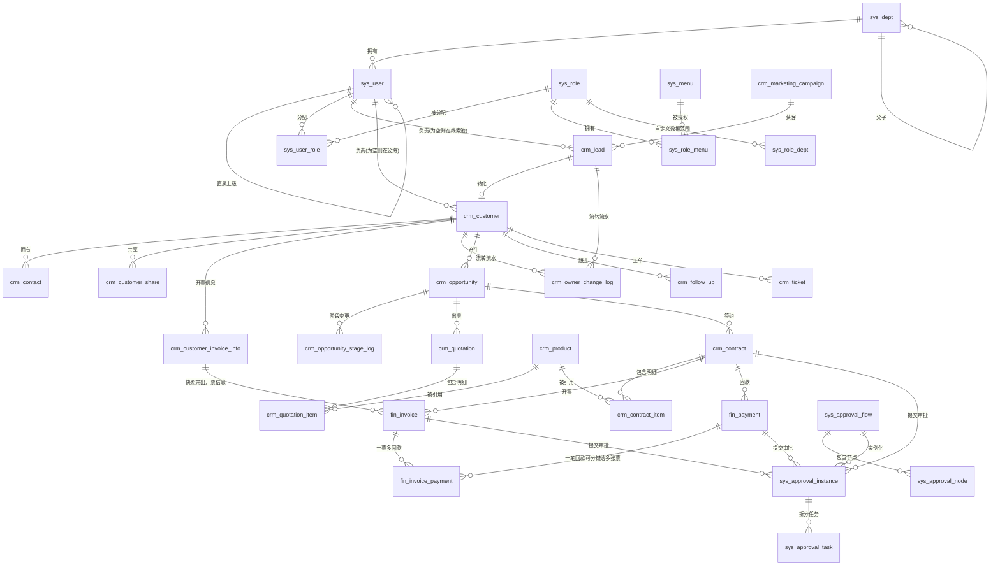
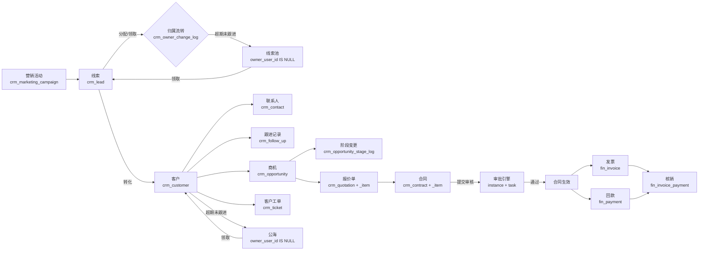
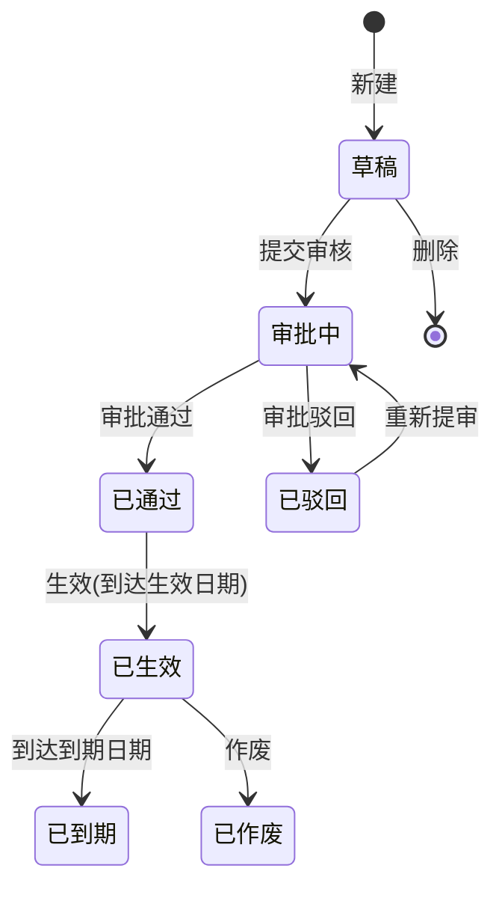

# 客户关系管理系统（CRM）数据库设计文档

## 文档信息

| 项目            | 内容                                      |
| :-------------- | :---------------------------------------- |
| **项目名称**    | 企业级智能CRM系统                         |
| **文档版本**    | V1.1                                      |
| **数据库类型**  | MySQL 8.0+（依赖生成列、ngram 全文索引解析器）|
| **字符集/引擎** | utf8mb4 / utf8mb4_0900_ai_ci / InnoDB     |
| **设计原则**    | 高内聚低耦合、逻辑删除、数据审计、AI赋能  |
| **编写日期**    | 2026-09-12                                |
| **配套脚本**    | `../sql/crm.sql` —— 49 张表全量可执行 DDL + 初始化数据 |
| **关联文档**    | 《CRM-原型梳理与接口优先级.md》—— 原型结构分析与接口开发优先级 |

> 📌 **权威性说明**：本文档描述**设计意图与决策理由**；`../sql/crm.sql` 是**字段级设计的唯一权威来源**。两者冲突时以脚本为准。

---

## 一、设计规范

### 1.1 命名规范

| 前缀 | 范围 |
| :--- | :--- |
| `sys_` | 系统基础、权限、审批、AI、通用支撑 |
| `crm_` | 客户业务（线索、客户、商机、报价、合同、产品、销售过程） |
| `fin_` | 财务（发票、回款） |

全部小写 + 下划线。索引命名：`idx_` 普通、`uk_` 唯一、`ft_` 全文。

### 1.2 基础审计字段（所有业务表强制）

```sql
create_by    BIGINT UNSIGNED  NULL                COMMENT '创建人ID',
create_time  DATETIME         NOT NULL DEFAULT CURRENT_TIMESTAMP COMMENT '创建时间',
update_by    BIGINT UNSIGNED  NULL                COMMENT '更新人ID',
update_time  DATETIME         NOT NULL DEFAULT CURRENT_TIMESTAMP COMMENT '更新时间',
del_flag     TINYINT UNSIGNED NOT NULL DEFAULT 0  COMMENT '删除标志(0存在 1删除)'
```

> ⚠️ **`update_time` 约定**：MySQL 的 `ON UPDATE CURRENT_TIMESTAMP` 在「值未变化时」不会更新，与业务预期不符。本项目**统一由应用层写入** `update_time` 与 `update_by`，DDL 中不声明 `ON UPDATE`。

> ⚠️ **`create_by` 的填充时机**：它由应用层的 `DBFieldHandler` 在插入时自动填充，
> **只有走代码写入的记录才有值**。`sql/crm.sql` 的演示数据 INSERT 是显式列出列名的，
> 当时没有列 `create_by`，所以 4.10 节专门用 `UPDATE` 给这些行补齐 ——
> 不补的话前端「创建人」列永远是 `--`（后端 6 个 RespVO 都提供 `creator`
> 且 Service 都会从 `create_by` 跨表补名，**代码是齐的，缺的只是数据**）。
> 详见 BUG-002。

### 1.3 数据类型规范

| 用途 | 类型 | 说明 |
| :--- | :--- | :--- |
| 主键 | `BIGINT UNSIGNED` | **统一雪花ID**（见 1.4）。不使用 `BIGINT(20)` 写法，括号宽度无意义 |
| 状态/枚举 | `TINYINT UNSIGNED` | ⚠️ **禁用 `TINYINT(1)`** —— 多数 ORM/JDBC 会映射为 `boolean`，导致 `audit_status=2/3` 丢信息 |
| 金额 | `DECIMAL(15,2)` | 单位：元。**本系统为单币种（CNY）**，不设币种字段 |
| 数量 | `DECIMAL(15,4)` | 支持小数计量单位 |
| 单价 | `DECIMAL(15,2)` | |
| 比率/税率/折扣 | `DECIMAL(5,2)` | 百分数值，如 `13.00` 表示 13% |
| 布尔语义 | `TINYINT UNSIGNED` | 0否 1是。不用 `BIT` |
| 时间 | `DATETIME` | **统一存储东八区（UTC+8）本地时间**，应用层不转 UTC |
| 纯日期 | `DATE` | |

### 1.4 主键策略

**统一采用雪花ID（Snowflake）**，由应用层生成后写入，不使用数据库自增。

理由：多模块单据（合同/发票/回款）存在跨表关联与外部对接场景，自增ID会暴露业务量且不利于后续分库分表。

> 若团队规模小、无分布式诉求，可退回 `BIGINT UNSIGNED AUTO_INCREMENT`，但**必须二选一并在全库统一**，不可混用。

### 1.5 逻辑删除与唯一约束 ⚠️

逻辑删除的表若直接建 `UNIQUE(contract_no)`，删除后编号将**永久被占用**，无法复用。

三种方案的取舍：

| 方案 | 做法 | 评价 |
| :--- | :--- | :--- |
| A. 联合唯一 | `UNIQUE(contract_no, del_flag)` | 简单，但「删除→重建同号→再删除」会冲突 |
| B. 删除时改写 | 删除时把 `contract_no` 改为 `原值_del_{id}` | 干净，但污染业务字段，且不可逆 |
| **C. 生成列（推荐）** | 见下 | 语义清晰，无副作用 |

**推荐方案 C**：

```sql
is_active TINYINT UNSIGNED GENERATED ALWAYS AS (IF(del_flag = 0, 1, NULL)) VIRTUAL COMMENT '唯一性守卫',
UNIQUE KEY uk_contract_no (contract_no, is_active)
```

原理：MySQL 唯一索引中 **NULL 之间不冲突**。存活行的 `is_active=1`，同一编号只能存在一条；已删除行的 `is_active=NULL`，可以无限多。

> 适用所有带业务唯一键的表：`contract_no`、`payment_no`、`apply_no`、`rule_code`、手机号等。

### 1.6 外键策略：逻辑外键，不用物理外键 ⚠️

**全库不建任何物理外键（`FOREIGN KEY`）**，表间关联一律通过**逻辑外键**维护 —— 即把关联字段当普通列存，引用完整性由应用层保证。

**为什么不用物理外键**

| 原因 | 说明 |
| :--- | :--- |
| **锁竞争** | 物理外键在写入时会对父表加锁，高并发下容易死锁 |
| **级联风险** | `ON DELETE CASCADE` 一旦配错，删一条记录可能连带清空多张表 |
| **与逻辑删除冲突** | 本库用 `del_flag` 逻辑删除，父行并不真正消失，物理外键的语义反而错位 |
| **阻碍分库分表** | 物理外键无法跨库，未来拆分时是硬阻塞 |
| **运维摩擦** | 造数、导数据、批量修数时，外键约束会持续碍事 |

**逻辑外键的四条约定**

1. **命名统一为 `<被引用表>_id`** —— `customer_id` 指向 `crm_customer.customer_id`，`contract_id` 指向 `crm_contract.contract_id`
2. **注释里写明指向** —— 如 `COMMENT '关联客户ID(crm_customer.customer_id)'`
3. **会作查询条件的必须建索引** —— 出现在 `WHERE` / `JOIN` 里的逻辑外键要建索引（这是替代物理外键性能收益的唯一手段）；仅用于展示、从不进入查询条件的关联字段可以不建，避免索引冗余
4. **类型必须与被引用主键完全一致** —— `BIGINT UNSIGNED`。类型不一致会导致 JOIN 时隐式转换，**索引直接失效**

**应用层必须补上物理外键原本提供的四件事**

| 物理外键原本保证 | 逻辑外键下由谁负责 |
| :--- | :--- |
| 插入时父行必须存在 | Service 层插入前校验（如新增合同前校验 `customer_id` 存在） |
| 删除父行时的引用检查 | 删除前检查从表引用；或直接用逻辑删除规避 |
| 级联删除 / 置空 | **不级联**。父表逻辑删除时，由应用层显式处理从表 |
| 完整性长期有效 | 定时巡检脚本，扫描孤儿数据并告警 |

**孤儿数据巡检示例**

```sql
-- 找出客户已被删除、但合同仍挂在该客户下的孤儿数据
SELECT c.contract_id, c.customer_id
  FROM crm_contract c
  LEFT JOIN crm_customer cu ON cu.customer_id = c.customer_id
 WHERE c.del_flag = 0
   AND (cu.customer_id IS NULL OR cu.del_flag = 1);
```

> 📌 **权衡要说清楚**：逻辑外键把完整性责任从**数据库**转移到了**应用层**。收益是并发性能与扩展性，代价是必须靠纪律兜底 —— 上面四条约定漏掉任何一条，都会慢慢积累脏数据。

### 1.7 性能约定

- **禁止深分页**：大表列表使用游标分页 `WHERE id < ? ORDER BY id DESC LIMIT 20`，或延迟关联
- **索引必带 `del_flag`**：高频组合索引末位加 `del_flag`
- **时间倒序列表**：**主表 / 单据表**（列表页默认按创建时间倒序）建 `create_time` 索引；**子表、配置表、关联表、流水表不需要** —— 它们的查询条件总带父 ID 或业务键，不存在单独按时间扫全表的场景
- **统计类查询**（销售漏斗、业绩报表）走**只读从库**，或预聚合到统计表

---

## 二、数据库表清单（共 49 张）

> 图例：🆕 本版新增的表
> 来源标注：【原型】= 原型有对应功能；【扩展】= 超出原型范围的合理扩展

### 1. 系统基础与权限模块（19 张，`sys_`）

| 序号 | 表名 | 表注释 | 来源 |
| :--- | :--- | :--- | :--- |
| 1 | `sys_dept` | 组织架构表 | 【原型】 |
| 2 | `sys_user` | 用户表 | 【原型】 |
| 3 | `sys_role` | 角色表 | 【原型】 |
| 3.1 | `sys_role_group` | 角色组表（纯分组标签，不参与权限判定） | 🆕【原型】 |
| 4 | `sys_user_role` | 用户角色关联表 | 【原型】 |
| 5 | `sys_role_menu` | 角色菜单关联表 | 🆕【原型】 |
| 6 | `sys_role_dept` | 角色部门关联表（自定义数据权限） | 🆕【原型】 |
| 7 | `sys_menu` | 菜单权限表 | 【原型】 |
| 8 | `sys_dict_type` | 字典类型表 | 【原型】 |
| 9 | `sys_dict_data` | 字典数据表 | 【原型】 |
| 10 | `sys_numbering_rule` | 编号规则表 | 🆕【原型】 |
| 10.1 | `sys_numbering_rule_item` | 编号规则项表 | 🆕【扩展】 |
| 10.2 | `sys_numbering_counter` | 编号分组流水计数器 | 🆕【扩展】 |
| 11 | `sys_unit` | 计量单位表 | 🆕【原型】 |
| 12 | `sys_attachment` | 附件表 | 【原型】 |
| 13 | `sys_notice` | 消息通知表 | 【原型】 |
| 14 | `sys_operation_log` | 操作日志表 | 【原型】 |
| 15 | `sys_login_log` | 登录日志表 | 【原型】 |
| 16 | `sys_data_change_log` | 数据变更审计表 | 🆕【扩展】 |

### 2. 审批流引擎（4 张，`sys_`）

| 序号 | 表名 | 表注释 | 来源 |
| :--- | :--- | :--- | :--- |
| 17 | `sys_approval_flow` | 审批流模板表 | 【原型】 |
| 18 | `sys_approval_node` | 审批流节点表 | 【原型】 |
| 19 | `sys_approval_instance` | 审批实例表 | 🆕【原型】 |
| 20 | `sys_approval_task` | 审批任务表 | 🆕【原型】 |

### 3. AI 能力（1 张，`sys_`）

| 序号 | 表名 | 表注释 | 来源 |
| :--- | :--- | :--- | :--- |
| 21 | `sys_ai_call_log` | AI调用日志表 | 【扩展】 |

### 4. 线索与客户模块（8 张，`crm_`）

| 序号 | 表名 | 表注释 | 来源 |
| :--- | :--- | :--- | :--- |
| 22 | `crm_pool_rule` | 公海规则配置表 | 【原型】 |
| 23 | `crm_lead` | 线索表 | 【原型】 |
| 24 | `crm_customer` | 客户表 | 【原型】 |
| 25 | `crm_contact` | 联系人表 | 【原型】 |
| 26 | `crm_customer_share` | 客户共享表 | 【原型】 |
| 27 | `crm_customer_invoice_info` | 客户开票信息表 | 🆕【原型】 |
| 28 | `crm_owner_change_log` | 归属流转记录表 | 🆕【原型】 |
| 29 | `crm_region` | 行政区划表（**可选**，也可仅用字段） | 🆕【扩展】 |

### 5. 产品 / 商机 / 报价模块（7 张，`crm_`）

| 序号 | 表名 | 表注释 | 来源 |
| :--- | :--- | :--- | :--- |
| 30 | `crm_product_category` | 产品分类表 | 【原型】 |
| 31 | `crm_product` | 产品表 | 【原型】 |
| 32 | `crm_opportunity` | 商机表 | 【原型】 |
| 33 | `crm_opportunity_stage_log` | 商机阶段变更记录表 | 【原型】 |
| 34 | `crm_opportunity_item` | 商机产品明细表 | 🆕【扩展】 |
| 35 | `crm_quotation` | 报价单主表 | 【原型】 |
| 36 | `crm_quotation_item` | 报价单明细表 | 【原型】 |

### 6. 合同与财务模块（5 张，`crm_` / `fin_`）

| 序号 | 表名 | 表注释 | 来源 |
| :--- | :--- | :--- | :--- |
| 37 | `crm_contract` | 合同表 | 【原型】 |
| 38 | `crm_contract_item` | 合同产品明细表 | 🆕【原型】 |
| 39 | `fin_payment` | 回款表 | 【原型】 |
| 40 | `fin_invoice` | 发票表 | 【原型】 |
| 41 | `fin_invoice_payment` | 发票回款明细表（一票多回款，唯一事实来源） | 🆕【原型】 |

### 7. 销售过程 / 营销 / 售后模块（4 张，`crm_`）

| 序号 | 表名 | 表注释 | 来源 |
| :--- | :--- | :--- | :--- |
| 42 | `crm_follow_up` | 跟进记录表 | 【扩展】 |
| 43 | `crm_sales_target` | 销售目标表 | 【扩展】 |
| 44 | `crm_marketing_campaign` | 营销活动表 | 【扩展】 |
| 45 | `crm_ticket` | 客户工单表 | 【扩展】 |

> **注意**：42-45 四张表**原型中没有对应功能页面**（原型 107 页中无跟进记录、销售目标、营销活动、售后工单模块），属主动扩展，非原型还原。

### 8. 通用能力（1 张，`crm_`）

| 序号 | 表名 | 表注释 | 来源 |
| :--- | :--- | :--- | :--- |
| 46 | `crm_star` | 关注收藏表（线索/客户/商机/报价单/合同/回款/发票共用） | 🆕【扩展】 |

> **为什么是通用表**：`crm_star` 只用 `biz_type + biz_id` 指向业务对象，不建外键，
> 所以七类单据共一张表。列名与取值约定见 3.x 节；`biz_type` 沿用
> `crm_follow_up` / `crm_owner_change_log` 的编号（1线索 2客户 3商机），
> 并按《05-接口文档》9.3 的 `tab` 顺序续到 4报价单 5合同 6回款 7发票 ——
> **同一张业务表在不同关联表里的编号不要漂移**。

### 9. 本版新增的表

| # | 表名 | 说明 |
| :--- | :--- | :--- |
| 1 | `sys_role_menu` | 角色-菜单关联（RBAC 核心） |
| 2 | `sys_role_dept` | 角色-部门关联（自定义数据权限） |
| 3 | `sys_numbering_rule` | 编号规则 |
| 4 | `sys_unit` | 计量单位 |
| 5 | `sys_data_change_log` | 数据变更审计 |
| 6 | `sys_approval_instance` | 审批实例 |
| 7 | `sys_approval_task` | 审批任务 |
| 8 | `crm_customer_invoice_info` | 客户开票信息 |
| 9 | `crm_owner_change_log` | 归属流转记录 |
| 10 | `crm_region` | 行政区划（可选） |
| 11 | `crm_contract_item` | 合同产品明细 |
| 12 | `fin_invoice_payment` | 发票回款明细（一票多回款） |
| 13 | `crm_opportunity_item` | 商机产品明细 |
| 14 | `crm_star` | 关注收藏（通用） |

> 与第二节表清单里标 🆕 的行数**必须一致**（当前 14）。漏了 `crm_opportunity_item`
> 或 `crm_star` 时，读者会以为它们不是本版新增、进而去别处找它们的定义。

---

## 三、核心设计决策

### 3.1 公海状态：单一真相 ⚠️

**常见陷阱**：用 `owner_user_id = 0` 加 `pool_status` 两个字段同时表达「是否在公海」，会产生 `owner_user_id=0 且 pool_status=0` 这类非法组合——两个字段各有各的真相，迟早对不上。

**决策**：**以 `owner_user_id` 为归属的唯一真相，删除 `pool_status`。**

```sql
owner_user_id BIGINT UNSIGNED NULL COMMENT '归属人ID，NULL 表示在公海/池中'
```

判定规则：
| 查询 | 条件 |
| :--- | :--- |
| 某人的私海客户 | `owner_user_id = ?` |
| 公海客户 | `owner_user_id IS NULL` |
| 某人的私海线索 | `owner_user_id = ?` |
| 线索池 | `owner_user_id IS NULL` |

**理由**：
1. 消除冗余，非法状态从结构上不可能出现
2. `IS NULL` 与 `= 0` 的索引效率相同
3. 少维护一个字段，减少一处写入 bug

**备选方案**（若不接受删字段）：保留 `pool_status` 作为唯一状态源，`owner_user_id` 允许 NULL，并用 CHECK 约束绑定：
```sql
CONSTRAINT ck_pool_owner CHECK ((pool_status = 0) = (owner_user_id IS NOT NULL))
```
但两字段仍需同步维护，不推荐。

**衍生字段约定**：
- `enter_pool_time` —— 进入公海时间（`owner_user_id` 由非空变 NULL 时写入）
- `enter_pool_reason_code` / `enter_pool_remark` —— **编码 + 备注**两字段（纯文本无法统计「为什么掉入公海」）
- `prev_owner_id` —— 保留，用于追溯

### 3.2 审批流：三层模型 ⚠️

**常见陷阱**：审批流只做「模板层」是不够的。如果缺少实例层，每种业务都得各建一套审批记录表（合同一套、发票一套、回款一套），「通用引擎」就名存实亡。

**决策**：采用四表三层结构：

```
【模板层】sys_approval_flow  ──1:N──>  sys_approval_node
                  │
                  │ 引用
                  ▼
【实例层】sys_approval_instance        (biz_type + biz_id 绑定业务单据)
                  │
                  │ 1:N
                  ▼
【任务层】sys_approval_task            (每个节点的审批人与处理结果)
```

**收益**：新增任何审批业务（如采购单、报销）**无需建表**，只需在 `sys_approval_flow` 配一条模板。

**关键设计点**：
- `sys_approval_instance` **不加** `UNIQUE(biz_type, biz_id)` —— 单据被驳回后需要重新提审，允许多条历史实例；查询「当前审批中」用 `WHERE status = 0`
- `sys_approval_task` 建 `(approver_id, task_status)` 索引 —— 这是「我的待办」列表的最高频查询
- 审批人解析方式（`approver_type`）支持：指定用户 / 指定角色 / 部门主管 / 发起人直属上级 / 发起人本人，解析结果落库到 `approver_id`（**不要把解析逻辑留到查询时**）

### 3.3 权限模型

**易漏点**：光有 `sys_menu`（菜单 / 按钮）和 `sys_role`（角色）还不够——**必须有角色-菜单关联表**，否则「这个角色能看到哪些菜单」无处存放，权限体系是断的。

**决策**：补全为标准的 RBAC：

```
sys_user ──N:M(via sys_user_role)──> sys_role ──N:M(via sys_role_menu)──> sys_menu
                                          │
                                          └──N:M(via sys_role_dept)──> sys_dept
```

`sys_data_scope` **删除**，其职责拆分为：
- `sys_role.data_scope TINYINT` —— 数据范围类型
- `sys_role_dept` —— 仅当 `data_scope = 2（自定义）` 时生效

> **补充：`sys_role_group` 与 `sys_role.group_id`**（后补）
>
> 原型里「角色权限」页有「新增角色组 / 删除角色组」两个按钮，`sys_menu` 里也早埋了
> `system:roleGroup:create` / `:delete` 两个权限点，但**建表时漏了这张表**，
> 导致该功能长期无表可依。现补上：
>
> ```
> sys_role_group ──1:N(via sys_role.group_id)──> sys_role
> ```
>
> ⚠️ **角色组不参与权限判定**，这是把它画在 RBAC 图之外的原因：
> 权限只看 `sys_role.role_key` + `data_scope` + `sys_role_menu`。
> 角色组的唯一作用是让角色列表能按「组」归类展示。
> 因此删组时只要把成员的 `group_id` 置回 `NULL`（=未分组）即可，**不影响任何权限**。

| `data_scope` | 含义 |
| :--- | :--- |
| 1 | 全部数据 |
| 2 | 自定义（查 `sys_role_dept`） |
| 3 | 本部门数据 |
| 4 | 本部门及以下数据 |
| 5 | 仅本人数据 |

### 3.4 数据权限落地方式 ⚠️ 最重要

数据权限是本系统的骨架——「负责人」字段、线索池/公海、角色权限、列表页查询，**四件事依赖同一套机制**。

**决策：在 DAO 层强制拦截，而非各 Service 自行拼条件。**

实现约定：

1. 用户登录后，将其所有角色的 `data_scope` **取最宽**，得到该用户最终的 `DataScope`
2. 提供统一拦截器，在 MyBatis 等 ORM 层对 SQL 自动追加数据范围条件。
   ⚠️ **完整取值与 SQL 见《04-权限设计文档》3.3，本节不再重复维护一份**（两处各写一套必然会漂移，
   本节原先写的 5 档只列了 2 档、且公海分支与 04 不一致，已改为引用）：

   ```sql
   -- data_scope = 5（仅本人）
   AND (owner_user_id IS NULL OR owner_user_id = #{currentUserId})
   -- data_scope = 4（本部门及以下）
   AND (owner_user_id IS NULL OR dept_id IN (本部门 + 全部子部门ID集合))
   -- data_scope = 3（本部门）
   AND (owner_user_id IS NULL OR dept_id = #{currentUserDeptId})
   -- data_scope = 2（自定义）
   AND (owner_user_id IS NULL OR dept_id IN (sys_role_dept 中配置的部门集合))
   -- data_scope = 1（全部）→ 不追加
   ```

   注意每个分支都带 `OR owner_user_id IS NULL`：**公海/线索池数据（负责人为空）对所有角色可见**
   （对应《04-权限设计文档》决策 4）。对 `owner_user_id` 为 `NOT NULL` 的单据表
   （合同 / 回款 / 发票），该分支恒为 false，条件自动退化成纯 scope 条件 ——
   所以不需要为「有公海概念的表」和「没有的」写两套逻辑。
3. **约束**：所有需要数据隔离的业务表必须同时具备 `owner_user_id` 和 `dept_id` 两个字段
   - 合同、发票、回款这类单据最容易漏掉这两个字段——漏了就没法做数据隔离
   - 参与数据权限的表清单见《04-权限设计文档》3.4（**含 `crm_quotation`**）

> 这条约定必须在 P0 阶段定稿并实现，否则后期每个接口都要返工。

### 3.5 其他决策

| 议题 | 决策 |
| :--- | :--- |
| 币种 | 单币种（CNY），不设 `currency_code`。若未来支持多币种，需在所有金额表加币种 + 汇率快照 |
| 时区 | 统一东八区本地时间，`DATETIME` 存储，应用层不换算 |
| 手机号/邮箱 | 涉及个人信息，建议**至少手机号加密存储**（AES），列表展示脱敏（`138****8888`），查看明文记审计日志 |
| 逻辑删除数据 | `del_flag=1` 数据定期归档到历史库（建议保留 6 个月），避免拖慢主表查询 |
| 金额一致性 | `crm_contract.amount` 必须等于 `crm_contract_item` 的 `amount` 汇总（含税），应用层校验 |
| **附件关联** | **关联关系存在业务表上**：需要挂附件的业务表加 `attachment_ids VARCHAR(500)`（逗号分隔的附件 ID 列表）。`sys_attachment.biz_type / biz_id` 保留但**改为可空**，仅作冗余，不再作为关联依据。详见 3.7 |

### 3.5.1 附件关联方式 ⚠️ 已改过一次，以本节为准

**决策：附件与业务单据的关联记在业务表上。**

```
1. 上传：POST /system/file/upload（multipart），只传文件本身，不传业务信息
         → 返回 { attachmentId, fileName, url }
2. 关联：把 attachmentId 追加到业务表的 attachment_ids 列
         → 新建单据时随创建请求一起提交；已有单据走业务自身的更新接口
3. 渲染：详情页读业务记录的 attachment_ids，逐个取附件信息
```

**为什么要这么改**：`sys_attachment.biz_type` / `biz_id` 原先是 `NOT NULL`，意味着
**上传时必须已经知道挂在哪张单据上**。但实际交互是「先在弹窗里选文件、点保存时单据才落库」——
单据 ID 在上传那一刻还不存在，`NOT NULL` 根本填不进去。

**目标 DDL**：

> ⚠️ **这套 DDL 尚未落地，本节目前是「设计」而非「现状」。** 已核对 `sql/crm.sql`
> 与线上库（2026-09-13）：`sys_attachment.biz_type` / `biz_id` 仍是 `NOT NULL`、
> `idx_biz` 索引仍在，三张业务表**都没有 `attachment_ids` 列**。
> 也就是说按本节流程写代码会直接失败（列不存在）。落地前先改 `sql/crm.sql`。

| 表 | 需要的变化 |
| :--- | :--- |
| `sys_attachment` | `biz_type` / `biz_id` 改为可空；删掉 `idx_biz` 索引 |
| `crm_customer` | 新增 `attachment_ids VARCHAR(500)`（客户详情「附件」Tab）|
| `crm_contract` | 新增 `attachment_ids VARCHAR(500)`（合同详情「附件」Tab）|
| `fin_invoice` | 新增 `attachment_ids VARCHAR(500)`（财务开票回填，对应接口 7.2 的 `attachmentIds`）|

**约定**：

- `attachment_ids` 存逗号分隔的 ID，如 `1001,1002`。**只存 ID，不存 URL** ——
  URL 会变（换存储、加 CDN），ID 才是稳定引用
- 其它表要用附件时按同样方式加列，**不要**回头去用 `sys_attachment.biz_type`
- 删除附件：从业务记录的 `attachment_ids` 里摘掉 ID 即可；`sys_attachment` 那行按逻辑删除处理
  （它可能被别的记录引用，不能物理删）

> ⚠️ 逗号分隔不是第一范式，但这是当前版本的取舍：它让上传与保存解耦、让一次请求就能带回单据的全部附件。
> 若将来附件数量或引用关系变复杂，再改成 `sys_attachment_biz` 关联表 —— 届时**只需改这一处**，
> 因为关联关系已经集中在业务表的这一个列上。

### 3.6 金额与数量计算口径 ⚠️ 必须实现前定稿

> 只写「金额」「含税」是不够的，**必须定义计算公式**。不定清楚，前后端一定会各写一套。

**统一约定：`unit_price` 为含税单价，`amount` 为含税行金额。**

**明细行（`crm_quotation_item` / `crm_contract_item` / `crm_opportunity_item`）**

```
折后单价   = unit_price × (1 - discount_rate / 100)
行金额     = ROUND(quantity × 折后单价, 2)          -- 含税
行不含税   = ROUND(行金额 / (1 + tax_rate / 100), 2)
行税额     = 行金额 - 行不含税
```

**单据合计（`crm_quotation`）**

```
total_with_tax = Σ 行金额          -- 逐行求和，不是对合计再算税
tax_amount     = Σ 行税额
total_amount   = total_with_tax - tax_amount
```

**发票（`fin_invoice`）**

发票是「一票多回款」，金额来自明细表 `fin_invoice_payment.write_off_amount`（每行**含税**），
再按发票级税率反算不含税与税额：

```
每行：lineAmount_k = ROUND(writeOffAmount_k / (1 + tax_rate/100), 2)   -- 不含税
      lineTax_k    = writeOffAmount_k − lineAmount_k                    -- 取残差

汇总：total_amount = Σ writeOffAmount_k    -- 价税合计
      amount       = Σ lineAmount_k        -- 不含税
      tax_amount   = Σ lineTax_k

恒等式：total_amount = amount + tax_amount
```

> ⚠️ **税额取残差，而不是重算 `amount × tax_rate / 100`** —— 只有前者能让上面的恒等式
> 精确成立（`Σ lineTax = Σ lineTotal − Σ lineAmount`）。单行时两种算法等价；
> 多行时重算乘法会与逐行四舍五入的结果差几分钱，正是下面第 1 条规则要避免的。
> 实现在 `InvoiceServiceImpl#splitTax`。

> ⚠️ **同一个列名 `total_amount`，在两张表里语义相反** ——
> `crm_quotation.total_amount` 是**不含税**合计（= 价税合计 − 税额），
> 而 `fin_invoice.total_amount` 是**价税合计**（= 不含税金额 + 税额）。
> 这是沿用 DDL 命名的结果，不是笔误。写业务代码时必须靠上下文区分，
> 对外 VO 建议分别暴露成 `amountExcludingTax`（报价单）与 `priceTaxTotal`（发票），
> 避免调用方按名字想当然。

**两条必须遵守的规则**：

1. **先逐行四舍五入，再汇总** —— 不能先把数量、金额汇总后再算税，否则明细与合计对不上（差几分钱，财务对账时会很痛苦）
2. **合同金额必须等于明细汇总** —— `crm_contract.amount == Σ crm_contract_item.amount`，保存时由服务端校验，不一致直接拒绝

> 📌 若未来要支持「单价不含税」的录入方式，需在明细表加 `price_mode TINYINT`（1含税 2不含税）字段，公式随之分支。当前版本统一按含税处理。

> 📌 **本版不计算利润** —— 全库**没有** `profit` / `gross_profit` 之类的列（`grep profit sql/crm.sql` 为 0 条）。
> 报价单与合同列表上的「整单利润」列**不在本期范围**：`crm_product.cost_price` 属于字段权限保护项
> （非授权角色取到的是 null），而且整单毛利还要分摊费用，口径未定义。
> 前端 `aurum-crm-ui` 的列表里目前还留着这一列（mock 遗留），接后端时应移除；
> 待毛利口径定义清楚后再加。

---

## 四、表结构详细设计

> **本章范围**：展开 **11 张新增表** 与 **4 张核心表**（客户 / 合同 / 发票 / 回款）的字段设计。
> 另有 `crm_opportunity_item`（结构与 `crm_contract_item` 完全一致，见 3.6 金额口径）
> 与 `crm_star` 不在此逐字段展开，直接看 `../sql/crm.sql`。
>
> 全部 49 张表的完整定义见 `../sql/crm.sql`；其余表的重点字段见第 16 节。

### 1. 角色菜单关联表（`sys_role_menu`）🆕

**表注释**：系统-角色与菜单的关联表（RBAC 核心）

| 字段名 | 数据类型 | 必填 | 默认值 | 说明 |
| :--- | :--- | :--- | :--- | :--- |
| `role_id` | BIGINT UNSIGNED | 是 | - | 角色ID |
| `menu_id` | BIGINT UNSIGNED | 是 | - | 菜单ID |

**索引设计**：
- `PRIMARY KEY (role_id, menu_id)` —— **复合主键本身即唯一约束**，无需再建 `UNIQUE KEY`
- `KEY idx_menu_id (menu_id)`

> 该表为纯关联表，无需审计字段与逻辑删除（授权变更直接物理增删）。

### 2. 角色部门关联表（`sys_role_dept`）🆕

**表注释**：系统-角色与部门的关联表（`data_scope=2 自定义` 时生效）

| 字段名 | 数据类型 | 必填 | 默认值 | 说明 |
| :--- | :--- | :--- | :--- | :--- |
| `role_id` | BIGINT UNSIGNED | 是 | - | 角色ID |
| `dept_id` | BIGINT UNSIGNED | 是 | - | 部门ID |

**索引设计**：
- `PRIMARY KEY (role_id, dept_id)` —— 同上，复合主键即唯一约束
- `KEY idx_dept_id (dept_id)`

### 3. 编号规则表（`sys_numbering_rule`）🆕

**表注释**：系统-单据编号生成规则（对应原型「基础设置 → 编号定义」）

| 字段名 | 数据类型 | 必填 | 默认值 | 说明 |
| :--- | :--- | :--- | :--- | :--- |
| `rule_id` | BIGINT UNSIGNED | 是 | - | 规则ID（主键） |
| `rule_code` | VARCHAR(32) | 是 | - | 规则编码（LEAD/CUSTOMER/OPP/QUOTE/CONTRACT/PAYMENT/INVOICE） |
| `rule_name` | VARCHAR(64) | 是 | - | 规则名称 |
| `prefix` | VARCHAR(32) | 否 | '' | 编号前缀，如 `HT` |
| `date_format` | VARCHAR(32) | 否 | 'yyyyMMdd' | 日期格式段，留空则不含日期 |
| `seq_length` | TINYINT UNSIGNED | 是 | 4 | 流水号位数（不足左补0） |
| `reset_cycle` | TINYINT UNSIGNED | 是 | 0 | 流水重置周期（0不重置 1按日 2按月 3按年） |
| `current_seq` | BIGINT UNSIGNED | 是 | 0 | 当前流水值 |
| `current_period` | VARCHAR(16) | 否 | NULL | 当前周期标识（如 20260912），用于判断是否重置 |
| `enabled` | TINYINT UNSIGNED | 是 | 1 | 是否启用（0禁用 1启用，对应原型开关） |
| `is_active` | TINYINT UNSIGNED | - | 生成列 | 唯一性守卫 |
| `remark` | VARCHAR(255) | 否 | NULL | 备注 |
| 审计字段 | | | | `create_by`/`create_time`/`update_by`/`update_time`/`del_flag` |

**索引设计**：
- `PRIMARY KEY (rule_id)`
- `UNIQUE KEY uk_rule_code (rule_code, is_active)`

> ⚠️ **并发要求**：生成编号必须保证唯一。实现上用 `SELECT ... FOR UPDATE` 锁定规则行后自增，或用 Redis 原子自增 + 定期回写。**不可在读-改-写之间不加锁**。

### 3.1 编号规则项表（`sys_numbering_rule_item`）

编号定义页保存的每个节点单独落库，`sort` 决定拼接顺序，`sequence_basis=1` 的节点参与流水分组。
支持的 `item_type` 为：`FIXED_PREFIX` 固定前缀、`FIXED_VALUE` 固定值、`YEAR`、`YEAR_SHORT`、
`MONTH`、`DAY`、`DATE`（`item_value` 保存 Java 日期格式）、`CUSTOMER`、`DEPARTMENT`、`SERIAL`。
系统业务前缀（合同 `HT`、回款 `HK`、发票 `FP`）由后端保护，前端不能修改或删除。

### 3.2 编号分组流水计数器（`sys_numbering_counter`）

每个 `(rule_id, basis_key)` 保存一条独立计数器。按年、按月以及按客户/部门分别编号时，
不同依据会生成不同的 `basis_key`，互不争用流水号；不重置时 `basis_key=ALL`。计数器使用唯一键和 CAS 更新保证并发下不重复。

> 存量数据库升级请执行 `sql/upgrade/alter-2026-09-14-numbering-rule-items.sql`。该脚本会新增两张编号表、
> 补默认节点，并校正「系统设置 → 编号定义」菜单及管理员权限；不会删除或重建业务表。
> 全新数据库使用 `sql/crm.sql` 即可。
>
> ⚠️ 那个脚本里的守卫条件是 `menu_name = '组织架构'`（按当时的叫法写的）。目录 `menu_id=70`
> 已于 2026-09-15 改名为「系统设置」—— **按日期顺序执行不受影响**（编号脚本在前），
> 但单独重跑它守卫会不成立。
>
> ⚠️ **导航改名没有增量脚本**（`crm.sql` 的种子已改，存量库需手工执行）：
> ```sql
> UPDATE `sys_menu` SET `menu_name` = '线索'     WHERE `menu_id` IN (10, 11);
> UPDATE `sys_menu` SET `menu_name` = '系统设置' WHERE `menu_id` = 70;
> ```
> 只改 `menu_name`，不动 `menu_id` / `parent_id` / `path` / `perms`，权限与路由都不受影响。

### 4. 计量单位表（`sys_unit`）🆕

**表注释**：系统-计量单位表（对应原型「基础设置 → 计量单位」）

| 字段名 | 数据类型 | 必填 | 默认值 | 说明 |
| :--- | :--- | :--- | :--- | :--- |
| `unit_id` | BIGINT UNSIGNED | 是 | - | 单位ID（主键） |
| `unit_name` | VARCHAR(32) | 是 | - | 单位名称（个/台/套/年） |
| `unit_code` | VARCHAR(32) | 是 | - | 单位编码 |
| `decimal_places` | TINYINT UNSIGNED | 是 | 0 | 数量小数位 |
| `sort` | SMALLINT UNSIGNED | 是 | 0 | 排序 |
| `status` | TINYINT UNSIGNED | 是 | 1 | 状态（0停用 1启用） |
| `is_active` | TINYINT UNSIGNED | - | 生成列 | 唯一性守卫 |
| 审计字段 | | | | |

**索引设计**：
- `PRIMARY KEY (unit_id)`
- `UNIQUE KEY uk_unit_code (unit_code, is_active)`

### 5. 客户开票信息表（`crm_customer_invoice_info`）🆕

**表注释**：CRM-客户开票信息（对应原型「客户详情 → 开票信息」Tab）

| 字段名 | 数据类型 | 必填 | 默认值 | 说明 |
| :--- | :--- | :--- | :--- | :--- |
| `info_id` | BIGINT UNSIGNED | 是 | - | 主键 |
| `customer_id` | BIGINT UNSIGNED | 是 | - | 客户ID |
| `invoice_title` | VARCHAR(128) | 是 | - | 开票名称（抬头） |
| `tax_no` | VARCHAR(64) | 否 | NULL | 纳税人识别号 |
| `bank_name` | VARCHAR(128) | 否 | NULL | 开户行 |
| `bank_account` | VARCHAR(64) | 否 | NULL | 银行账号 |
| `invoice_addr` | VARCHAR(255) | 否 | NULL | 开票地址 |
| `invoice_phone` | VARCHAR(32) | 否 | NULL | 开票电话 |
| `is_default` | TINYINT UNSIGNED | 是 | 0 | 是否默认（0否 1是） |
| 审计字段 | | | | |

**索引设计**：
- `PRIMARY KEY (info_id)`
- `KEY idx_customer_id (customer_id, del_flag)`

> 允许一个客户维护多条开票信息（如不同签约主体），用 `is_default` 标记默认项。

### 6. 归属流转记录表（`crm_owner_change_log`）🆕

**表注释**：CRM-归属变更流水（合并原 `crm_lead_assign_log` 与 `crm_customer_assign_log`）

| 字段名 | 数据类型 | 必填 | 默认值 | 说明 |
| :--- | :--- | :--- | :--- | :--- |
| `log_id` | BIGINT UNSIGNED | 是 | - | 主键 |
| `biz_type` | TINYINT UNSIGNED | 是 | - | 业务类型（1线索 2客户） |
| `biz_id` | BIGINT UNSIGNED | 是 | - | 业务ID |
| `biz_name` | VARCHAR(128) | 否 | NULL | 业务名称快照（冗余，便于列表直接展示） |
| `action` | TINYINT UNSIGNED | 是 | - | 动作（1分配 2领取 3放入公海 4规则自动回收 5管理员改派 6线索转化） |
| `from_owner_id` | BIGINT UNSIGNED | 否 | NULL | 原归属人（NULL 表示原在公海） |
| `to_owner_id` | BIGINT UNSIGNED | 否 | NULL | 新归属人（NULL 表示进入公海） |
| `reason_code` | TINYINT UNSIGNED | 否 | NULL | 原因编码（走字典 `crm_pool_reason`） |
| `reason_remark` | VARCHAR(255) | 否 | NULL | 原因备注 |
| `operator_id` | BIGINT UNSIGNED | 否 | NULL | 操作人ID（规则自动回收时为 NULL） |
| `create_time` | DATETIME | 是 | CURRENT_TIMESTAMP | 操作时间 |

**索引设计**：
- `PRIMARY KEY (log_id)`
- `KEY idx_biz (biz_type, biz_id, create_time)` —— 查某条线索/客户的流转历史
- `KEY idx_to_owner (to_owner_id, create_time)` —— 查某人领了多少（用于「领取上限」校验）

> 该表为**只追加流水**，不做逻辑删除、不做更新。

### 7. 行政区划表（`crm_region`）🆕 🔸可选

**表注释**：CRM-省市区三级区划（对应原型「新增客户」的省市区三级联动）

| 字段名 | 数据类型 | 必填 | 默认值 | 说明 |
| :--- | :--- | :--- | :--- | :--- |
| `region_id` | BIGINT UNSIGNED | 是 | - | 主键 |
| `parent_id` | BIGINT UNSIGNED | 是 | 0 | 父级ID（0为顶级） |
| `region_name` | VARCHAR(64) | 是 | - | 区划名称 |
| `region_level` | TINYINT UNSIGNED | 是 | - | 层级（1省 2市 3区县） |
| `region_code` | VARCHAR(12) | 是 | - | 国标行政区划代码 |
| `sort` | SMALLINT UNSIGNED | 是 | 0 | 排序 |

**索引设计**：
- `PRIMARY KEY (region_id)`
- `KEY idx_parent (parent_id)`
- `UNIQUE KEY uk_region_code (region_code)`

> **可选**：若只需存储客户的省市区文本，也可不加此表，直接在 `crm_customer` 上加 `province`/`city`/`district` 三个字段 + `region_code`。建议做选择器时保留此表。

### 8. 数据变更审计表（`sys_data_change_log`）🆕

**表注释**：系统-核心单据字段级变更审计

| 字段名 | 数据类型 | 必填 | 默认值 | 说明 |
| :--- | :--- | :--- | :--- | :--- |
| `log_id` | BIGINT UNSIGNED | 是 | - | 主键 |
| `biz_type` | VARCHAR(32) | 是 | - | 业务类型（contract/invoice/payment） |
| `biz_id` | BIGINT UNSIGNED | 是 | - | 业务ID |
| `field_name` | VARCHAR(64) | 是 | - | 字段名 |
| `field_label` | VARCHAR(64) | 否 | NULL | 字段中文名（便于展示） |
| `old_value` | TEXT | 否 | NULL | 变更前值 |
| `new_value` | TEXT | 否 | NULL | 变更后值 |
| `changed_by` | BIGINT UNSIGNED | 是 | - | 变更人 |
| `changed_time` | DATETIME | 是 | CURRENT_TIMESTAMP | 变更时间 |
| `change_source` | TINYINT UNSIGNED | 是 | 1 | 来源（1人工 2AI 3系统） |

**索引设计**：
- `PRIMARY KEY (log_id)`
- `KEY idx_biz (biz_type, biz_id, changed_time)`

> **建议启用范围**：涉及金额与状态的核心单据（合同、发票、回款）。全表启用会带来较大写入放大。

### 9. 审批实例表（`sys_approval_instance`）🆕

**表注释**：系统-审批实例（绑定具体业务单据）

| 字段名 | 数据类型 | 必填 | 默认值 | 说明 |
| :--- | :--- | :--- | :--- | :--- |
| `instance_id` | BIGINT UNSIGNED | 是 | - | 主键 |
| `flow_id` | BIGINT UNSIGNED | 是 | - | 审批流模板ID |
| `biz_type` | VARCHAR(32) | 是 | - | 业务类型（contract/invoice/payment） |
| `biz_id` | BIGINT UNSIGNED | 是 | - | 业务单据ID |
| `biz_no` | VARCHAR(64) | 否 | NULL | 单据编号快照（冗余，列表直接展示） |
| `title` | VARCHAR(255) | 否 | NULL | 审批标题 |
| `apply_user_id` | BIGINT UNSIGNED | 是 | - | 发起人 |
| `apply_dept_id` | BIGINT UNSIGNED | 否 | NULL | 发起人部门 |
| `current_node_order` | SMALLINT UNSIGNED | 是 | 1 | 当前节点顺序 |
| `status` | TINYINT UNSIGNED | 是 | 0 | 状态（0审批中 1已通过 2已驳回 3已撤销） |
| `start_time` | DATETIME | 是 | CURRENT_TIMESTAMP | 发起时间 |
| `end_time` | DATETIME | 否 | NULL | 结束时间 |
| 审计字段 | | | | |

**索引设计**：
- `PRIMARY KEY (instance_id)`
- `KEY idx_biz (biz_type, biz_id, status)` —— 查某单据的当前审批（**不加 UNIQUE**，允许驳回后重新提审产生多条历史）
- `KEY idx_apply_user (apply_user_id, status)` —— 我发起的

### 10. 审批任务表（`sys_approval_task`）🆕

**表注释**：系统-审批任务（每个节点的审批人与处理结果）

| 字段名 | 数据类型 | 必填 | 默认值 | 说明 |
| :--- | :--- | :--- | :--- | :--- |
| `task_id` | BIGINT UNSIGNED | 是 | - | 主键 |
| `instance_id` | BIGINT UNSIGNED | 是 | - | 审批实例ID |
| `node_id` | BIGINT UNSIGNED | 否 | NULL | 来源模板节点ID |
| `node_order` | SMALLINT UNSIGNED | 是 | - | 节点顺序 |
| `node_name` | VARCHAR(64) | 否 | NULL | 节点名称快照 |
| `approve_type` | TINYINT UNSIGNED | 是 | 1 | 审批方式（1或签 2会签 3依次） |
| `approver_id` | BIGINT UNSIGNED | 是 | - | **实际审批人ID（解析后落库）** |
| `task_status` | TINYINT UNSIGNED | 是 | 0 | 任务状态（0待办 1已办 2已跳过） |
| `approve_result` | TINYINT UNSIGNED | 否 | NULL | 审批结果（1通过 2驳回 3撤销） |
| `comment` | VARCHAR(500) | 否 | NULL | 审批意见 |
| `handle_time` | DATETIME | 否 | NULL | 处理时间 |
| `create_time` | DATETIME | 是 | CURRENT_TIMESTAMP | 创建时间 |

**索引设计**：
- `PRIMARY KEY (task_id)`
- `KEY idx_todo (approver_id, task_status, create_time)` —— **「我的待办」最高频查询**
- `KEY idx_instance (instance_id, node_order)`

> ⚠️ **关键**：`approver_id` 必须是**模板解析后的具体人**，而不是存「角色ID」留到查询时再解析。否则审批人变更会导致历史任务的归属漂移。

### 11. 合同产品明细表（`crm_contract_item`）🆕

**表注释**：CRM-合同产品明细（对应原型合同页「添加产品」）

| 字段名 | 数据类型 | 必填 | 默认值 | 说明 |
| :--- | :--- | :--- | :--- | :--- |
| `item_id` | BIGINT UNSIGNED | 是 | - | 主键 |
| `contract_id` | BIGINT UNSIGNED | 是 | - | 合同ID |
| `product_id` | BIGINT UNSIGNED | 否 | NULL | 产品ID |
| `product_name` | VARCHAR(128) | 是 | - | 产品名称快照 |
| `product_type_id` | BIGINT UNSIGNED | 否 | NULL | 产品分类快照 |
| `unit_id` | BIGINT UNSIGNED | 否 | NULL | 计量单位 |
| `quantity` | DECIMAL(15,4) | 是 | 1 | 数量 |
| `unit_price` | DECIMAL(15,2) | 是 | 0.00 | 单价（含税） |
| `discount_rate` | DECIMAL(5,2) | 否 | 0.00 | 折扣率（%） |
| `tax_rate` | DECIMAL(5,2) | 否 | 0.00 | 税率（%） |
| `amount` | DECIMAL(15,2) | 是 | 0.00 | 行金额（含税） |
| `sort` | SMALLINT UNSIGNED | 是 | 0 | 排序 |
| `remark` | VARCHAR(255) | 否 | NULL | 备注 |
| 审计字段 | | | | |

**索引设计**：
- `PRIMARY KEY (item_id)`
- `KEY idx_contract_id (contract_id, del_flag)`
- `KEY idx_product_id (product_id)`

> **快照原则**：`product_name`/`unit_price` 等必须冗余存快照。产品改价或下架后，历史合同明细不能跟着变。
> `crm_quotation_item` 应保持与之一致的字段结构。

### 12. 发票表（`fin_invoice`）

**表注释**：财务-发票表

| 字段名 | 数据类型 | 必填 | 默认值 | 说明 |
| :--- | :--- | :--- | :--- | :--- |
| `invoice_id` | BIGINT UNSIGNED | 是 | - | 主键 |
| `apply_no` | VARCHAR(64) | 是 | - | **发票申请编号**（系统生成，对应原型搜索字段） |
| `invoice_no` | VARCHAR(64) | 否 | NULL | **实际发票号**（开票后回填，申请时为空） |
| `payment_id` | BIGINT UNSIGNED | 否 | NULL | **主回款ID**（去规范化，取明细表首条；展示与索引用，事实来源见 `fin_invoice_payment`） |
| `contract_id` | BIGINT UNSIGNED | 否 | NULL | 关联合同ID（仅当全部明细同属一份合同时才有值，否则 NULL） |
| `customer_id` | BIGINT UNSIGNED | 是 | - | 关联客户ID（由所选回款推导） |
| `owner_user_id` | BIGINT UNSIGNED | 是 | - | **归属人ID**（数据权限用） |
| `dept_id` | BIGINT UNSIGNED | 否 | NULL | **归属部门ID**（数据权限用） |
| `invoice_type` | TINYINT UNSIGNED | 是 | 1 | 发票类型（1增值税专票 2增值税普票 3电子专票 4电子普票） |
| `invoice_title` | VARCHAR(128) | 否 | NULL | 开票名称（抬头）——**客户开票信息快照** |
| `tax_no` | VARCHAR(64) | 否 | NULL | 纳税人识别号（快照） |
| `bank_name` | VARCHAR(128) | 否 | NULL | 开户行（快照） |
| `bank_account` | VARCHAR(64) | 否 | NULL | 银行账号（快照） |
| `invoice_addr` | VARCHAR(255) | 否 | NULL | 开票地址（快照） |
| `invoice_phone` | VARCHAR(32) | 否 | NULL | 开票电话（快照） |
| `amount` | DECIMAL(15,2) | 是 | 0.00 | 不含税金额 |
| `tax_rate` | DECIMAL(5,2) | 是 | 0.00 | 税率（%） |
| `tax_amount` | DECIMAL(15,2) | 是 | 0.00 | 税额 |
| `total_amount` | DECIMAL(15,2) | 是 | 0.00 | 价税合计 |
| `apply_date` | DATE | 是 | - | 申请日期 |
| `issue_date` | DATE | 否 | NULL | 开票日期 |
| `issue_user_id` | BIGINT UNSIGNED | 否 | NULL | 开票人（财务） |
| `audit_status` | TINYINT UNSIGNED | 是 | 0 | 审核状态（0待提审 1审批中 2已通过 3已驳回） |
| `status` | TINYINT UNSIGNED | 是 | 0 | 单据状态（0待开票 1已开票 2已作废） |
| `is_active` | TINYINT UNSIGNED | - | 生成列 | 唯一性守卫（配合 `uk_apply_no`，与 `payment_id` 无关） |
| `remark` | VARCHAR(500) | 否 | NULL | 备注 |
| 审计字段 | | | | |

**索引设计**：
- `PRIMARY KEY (invoice_id)`
- `UNIQUE KEY uk_apply_no (apply_no, is_active)`
- `KEY idx_payment_id (payment_id)` —— 主回款（已无唯一约束，见下）
- `KEY idx_invoice_no (invoice_no)`
- `KEY idx_contract_id (contract_id, del_flag)`
- `KEY idx_customer_id (customer_id, del_flag)`
- `KEY idx_owner (owner_user_id, dept_id, del_flag)` —— 数据权限 + 列表
- `KEY idx_audit_status (audit_status, del_flag)` —— 待审核列表
- `KEY idx_status (status, del_flag)` —— 待开票 / 已开票筛选

> ⚠️ **原 `uk_payment_active (payment_id, is_active)` 已删除**。它强制「一笔回款只能开一张票」，
> 与「一张票合并多笔回款」的模型直接冲突；而且唯一索引对 NULL 不生效，多回款发票的
> `payment_id` 为 NULL 时会**静默绕过**它 —— 看着有约束，其实没有。
> 并发保护改由保存时对所选回款按 `payment_id` 升序加行锁承担，
> 校验规则改为「跨发票累计开票金额不超过该回款金额」。

> 📌 **六个开票信息字段是快照**，列名与 `crm_customer_invoice_info` 逐字相同（1:1 透传）。
> 选中客户时从该客户的默认开票信息带出、允许改动；落库后即与客户档案解耦 ——
> 客户日后改了抬头或账号，已开出的发票不应跟着变。历史数据为 NULL 属正常（无来源行）。
- `KEY idx_apply_date (apply_date)` —— 按日期统计
- `KEY idx_create_time (create_time)`

> **⚠️ 易混淆点**：**申请编号**与**实际发票号**是两个独立概念——申请时只有申请号，财务开票后才回填真实发票号。原型搜索框「发票申请编号 / 发票号」也印证了这点，所以拆成两个字段而不是一个。

### 13. 回款表（`fin_payment`）

**表注释**：财务-回款表

| 字段名 | 数据类型 | 必填 | 默认值 | 说明 |
| :--- | :--- | :--- | :--- | :--- |
| `payment_id` | BIGINT UNSIGNED | 是 | - | 主键 |
| `payment_no` | VARCHAR(64) | 是 | - | 回款编号（系统生成） |
| `contract_id` | BIGINT UNSIGNED | 否 | NULL | 关联合同ID |
| `customer_id` | BIGINT UNSIGNED | 是 | - | 关联客户ID |
| `owner_user_id` | BIGINT UNSIGNED | 是 | - | **归属人ID**（数据权限用） |
| `dept_id` | BIGINT UNSIGNED | 否 | NULL | **归属部门ID** |
| `amount` | DECIMAL(15,2) | 是 | 0.00 | 回款金额 |
| `payment_date` | DATE | 是 | - | 回款日期 |
| `payment_method` | TINYINT UNSIGNED | 是 | 1 | 回款方式（1银行转账 2现金 3支票 4在线支付 5其他） |
| `account_name` | VARCHAR(128) | 否 | NULL | 收款账户名 |
| `account_no` | VARCHAR(64) | 否 | NULL | 收款账号 |
| `serial_no` | VARCHAR(128) | 否 | NULL | 银行流水号 |
| `audit_status` | TINYINT UNSIGNED | 是 | 0 | 审核状态（0待提审 1审批中 2已通过 3已驳回） |
| `status` | TINYINT UNSIGNED | 是 | 0 | 单据状态（0待确认 1已确认 2已作废） |
| `is_active` | TINYINT UNSIGNED | - | 生成列 | 唯一性守卫 |
| `remark` | VARCHAR(500) | 否 | NULL | 备注 |
| 审计字段 | | | | |

**索引设计**：
- `PRIMARY KEY (payment_id)`
- `UNIQUE KEY uk_payment_no (payment_no, is_active)`
- `KEY idx_contract_id (contract_id, del_flag)`
- `KEY idx_customer_id (customer_id, del_flag)`
- `KEY idx_owner (owner_user_id, dept_id, del_flag)`
- `KEY idx_audit_status (audit_status, del_flag)` —— 待审核列表
- `KEY idx_payment_date (payment_date)`
- `KEY idx_serial_no (serial_no)` —— 防重复登记
- `KEY idx_create_time (create_time)`

### 14. 合同表（`crm_contract`）

**表注释**：CRM-合同表

| 字段名 | 数据类型 | 必填 | 默认值 | 说明 |
| :--- | :--- | :--- | :--- | :--- |
| `contract_id` | BIGINT UNSIGNED | 是 | - | 合同ID（主键） |
| `contract_no` | VARCHAR(64) | 是 | - | 合同编号（唯一，编号规则生成） |
| `contract_name` | VARCHAR(128) | 是 | - | 合同名称 |
| `customer_id` | BIGINT UNSIGNED | 是 | - | 关联客户ID |
| `opportunity_id` | BIGINT UNSIGNED | 否 | NULL | 关联商机ID（**1:N，可空**） |
| `quotation_id` | BIGINT UNSIGNED | 否 | NULL | 关联报价单ID |
| `owner_user_id` | BIGINT UNSIGNED | 是 | - | **归属人ID** 🆕 |
| `dept_id` | BIGINT UNSIGNED | 否 | NULL | **归属部门ID** 🆕 |
| `contract_type` | TINYINT UNSIGNED | 否 | 1 | 合同类型（1销售合同 2框架合同 3补充协议） |
| `amount` | DECIMAL(15,2) | 是 | 0.00 | 合同金额（含税，须等于明细汇总） |
| `sign_date` | DATE | 否 | NULL | 签订日期 🆕 |
| `start_date` | DATE | 否 | NULL | 生效日期 |
| `end_date` | DATE | 否 | NULL | 到期日期 |
| `customer_signer` | VARCHAR(64) | 否 | NULL | 客户签约人 |
| `company_signer` | VARCHAR(64) | 否 | NULL | 公司签约人 |
| `audit_status` | TINYINT UNSIGNED | 是 | 0 | 审核状态（0待提审 1审批中 2已通过 3已驳回） |
| `status` | TINYINT UNSIGNED | 是 | 0 | 合同状态（0草稿 1已生效 2已作废 3已到期） |
| `is_active` | TINYINT UNSIGNED | - | 生成列 | 唯一性守卫 |
| 审计字段 | | | | |

**索引设计**：
- `PRIMARY KEY (contract_id)`
- `UNIQUE KEY uk_contract_no (contract_no, is_active)`
- `KEY idx_customer_id (customer_id, del_flag)`
- `KEY idx_owner (owner_user_id, dept_id, del_flag)` —— 数据权限 + 列表 🆕
- `KEY idx_opportunity_id (opportunity_id)` 🆕
- `KEY idx_quotation_id (quotation_id)` 🆕
- `KEY idx_audit_status (audit_status, del_flag)` —— 待审核列表 🆕
- `KEY idx_status (status, del_flag)` 🆕
- `KEY idx_sign_date (sign_date)` —— 按签约日期统计 🆕
- `KEY idx_end_date (end_date)` —— 合同到期扫描 🆕
- `KEY idx_create_time (create_time)` 🆕
- `FULLTEXT KEY ft_contract_name (contract_name) WITH PARSER ngram` 🆕

### 15. 客户表（`crm_customer`）

**表注释**：CRM-客户表（核心资产）

| 字段名 | 数据类型 | 必填 | 默认值 | 说明 |
| :--- | :--- | :--- | :--- | :--- |
| `customer_id` | BIGINT UNSIGNED | 是 | - | 客户ID（主键） |
| `customer_no` | VARCHAR(64) | 是 | - | 客户编号（编号规则生成，业务唯一） |
| `customer_name` | VARCHAR(128) | 是 | - | 客户名称 |
| `lead_id` | BIGINT UNSIGNED | 否 | NULL | **来源线索ID**（可空——支持直接新增客户）🆕 |
| `industry` | TINYINT UNSIGNED | 否 | NULL | 所属行业（字典 `crm_industry`） |
| `level` | TINYINT UNSIGNED | 是 | 2 | 客户级别（1重要 2普通 3非优先） |
| `source` | TINYINT UNSIGNED | 否 | NULL | 客户来源（字典 `crm_source`） |
| `phone` | VARCHAR(255) | 否 | NULL | 联系电话（加密存储需扩容） |
| `email` | VARCHAR(128) | 否 | NULL | 邮箱 |
| `website` | VARCHAR(255) | 否 | NULL | 官网 |
| `province` | VARCHAR(32) | 否 | NULL | 省 🆕 |
| `city` | VARCHAR(32) | 否 | NULL | 市 🆕 |
| `district` | VARCHAR(32) | 否 | NULL | 区县 🆕 |
| `region_code` | VARCHAR(12) | 否 | NULL | 行政区划代码 🆕 |
| `address` | VARCHAR(255) | 否 | NULL | 详细地址 |
| `owner_user_id` | BIGINT UNSIGNED | 否 | NULL | 归属人ID（**NULL = 在公海**） |
| `dept_id` | BIGINT UNSIGNED | 否 | NULL | 归属部门ID（数据权限用）🆕 |
| `enter_pool_time` | DATETIME | 否 | NULL | 进入公海时间 |
| `enter_pool_reason_code` | TINYINT UNSIGNED | 否 | NULL | 进入公海原因编码（字典 `crm_pool_reason`） |
| `enter_pool_remark` | VARCHAR(255) | 否 | NULL | 进入公海原因备注 🆕 |
| `prev_owner_id` | BIGINT UNSIGNED | 否 | NULL | 前归属人ID |
| `last_follow_time` | DATETIME | 否 | NULL | **最后跟进时间**（公海回收判定依据）🆕 |
| `remark` | VARCHAR(500) | 否 | NULL | 备注 |
| `is_active` | TINYINT UNSIGNED | - | 生成列 | 唯一性守卫，与 `customer_no` 组成唯一键 |
| 审计字段 | | | | |

**索引设计**：
- `PRIMARY KEY (customer_id)`
- `UNIQUE KEY uk_customer_no (customer_no, is_active)` —— 客户编号唯一（逻辑删除友好）
- `KEY idx_owner (owner_user_id, dept_id, del_flag)` —— 数据权限 + 私海/公海查询
- `KEY idx_pool_recycle (owner_user_id, last_follow_time)` —— 🆕公海自动回收定时任务
- `FULLTEXT KEY ft_customer_name (customer_name) WITH PARSER ngram` —— 名称搜索
- `KEY idx_lead_id (lead_id)` 🆕
- `KEY idx_create_time (create_time)` 🆕
- `KEY idx_phone (phone)` 🆕（注意：加密存储后此索引只能用于精确匹配）

> **⚠️ 本表没有 `pool_status` 字段** —— 判定公海统一用 `owner_user_id IS NULL`（见 3.1），避免双字段冗余。

### 16. 其他表的重点字段（易漏清单）

> 下表从脚本中挑出**对实现影响最大**的字段。完整定义见 `../sql/crm.sql`。

**① 数据权限相关** —— 不实现这些，数据权限跑不起来

| 表 | 字段 | 为什么重要 |
| :--- | :--- | :--- |
| `sys_dept` | `ancestors` | 祖级列表（如 `0,1,3`）。「本部门及以下」数据范围直接用它做前缀匹配，**避免递归查树** |
| `sys_dept` | `type` | 组织层级：**1 集团 / 2 部门 / 3 组**。三级节点在前端组织架构页显示不同的徽标底色。⚠️ 前端传的 value 是**英文字符串** `group`/`dept`/`team`，后端做转换 |
| `sys_role` | `data_scope` | 数据范围类型（1全部 2自定义 3本部门 4本部门及以下 5仅本人） |
| `sys_user` | `superior_id` | 直属上级。审批流「发起人直属上级」节点靠它解析 |
| `sys_user` | `status` | 三态：1正常 2禁用 3离职（对应原型「激活 / 禁用 / 操作离职」） |
| 所有业务表 | `owner_user_id` + `dept_id` | 二者必须同时存在，见 3.4 |

**② 业务编号字段** —— 全部由编号规则引擎生成，不要用自增

`crm_lead.lead_no`、`crm_customer.customer_no`、`crm_opportunity.opportunity_no`、`crm_quotation.quotation_no`、`crm_contract.contract_no`、`fin_payment.payment_no`、`fin_invoice.apply_no`、`crm_product.product_no`、`crm_marketing_campaign.campaign_no`、`crm_ticket.ticket_no`

**③ 状态与统计字段**

| 表 | 字段 | 说明 |
| :--- | :--- | :--- |
| `crm_opportunity` | `win_rate` | 赢单概率（%），AI 预测结果写这里 |
| `crm_opportunity` | `actual_close_date` | 实际成交日期，与 `expected_close_date` 配对，用于评估预测准确率 |
| `crm_quotation` | `version` | 版本号 —— 一个商机可出多版报价单 |
| `crm_quotation` | `total_amount`（**不含税**）/ `tax_amount`（税额）/ `total_with_tax`（价税合计）| 三个金额字段，计算口径见 3.6。⚠️ 注意与 `fin_invoice.total_amount`（价税合计）**同名不同义** |
| `crm_product_category` | `ancestors` | 分类树，用法同 `sys_dept` |
| `crm_lead` | `convert_time` / `converted_customer_id` | 线索转化追踪，用于算线索转化率 |
| `crm_follow_up` | `source` / `ai_confidence` / `ai_call_id` | 区分人工与 AI 生成内容 |

**④ 菜单与按钮权限**

| 表 | 字段 | 说明 |
| :--- | :--- | :--- |
| `sys_menu` | `menu_type` | 1目录 2菜单 **3按钮** —— 按钮级权限靠它 |
| `sys_menu` | `perms` | 权限标识（如 `crm:customer:list`），后端 `@PreAuthorize` 使用 |

---

## 五、索引与性能规范

### 5.1 名称搜索索引 ⚠️

名称搜索有一个很容易踩的坑：给 `customer_name` 建普通 B-Tree 索引，以为能加速搜索——但名称搜索必然是 `LIKE '%关键字%'`，**前导通配符下 B-Tree 索引完全失效**，会退化成全表扫描。索引白建了。

三种正确做法：

| 方案 | 写法 | 适用 |
| :--- | :--- | :--- |
| 全文索引（推荐） | `FULLTEXT KEY ft_name (customer_name) WITH PARSER ngram` + `MATCH ... AGAINST` | MySQL 8，支持中文分词 |
| 前缀匹配 | `LIKE '关键字%'` | 用户接受从左匹配 |
| 外部搜索引擎 | Elasticsearch | 多字段复杂搜索、数据量大 |

**建议**：客户名、线索名、商机名、合同名、产品名**统一使用全文索引**（脚本中已实现）；`sys_*` 配置类表（字典、单位、编号规则）数据量小，用 `LIKE '关键字%'` 前缀匹配即可。

> ⚠️ 使用全文索引时，查询必须写成 `MATCH(col) AGAINST('关键字' IN BOOLEAN MODE)`，写成 `LIKE` 依然用不上索引。

### 5.2 公海回收定时任务

定时扫描「超期未跟进」的私海数据时，有两个容易踩的坑：

1. **判定字段**：不要用 `update_time`——它会被任何字段修改刷新，改个错别字就能把回收倒计时重置。要用 `last_follow_time`（真实跟进时间）
2. **索引必须匹配**：回收查询的条件里没有 `owner_user_id = ?`，所以「按负责人」建的索引覆盖不到，需要单独的复合索引

正确的查询与索引：
```sql
SELECT customer_id FROM crm_customer
 WHERE owner_user_id IS NOT NULL
   AND del_flag = 0
   AND (last_follow_time IS NULL OR last_follow_time < ?);

KEY idx_pool_recycle (owner_user_id, last_follow_time)
```

### 5.3 数据权限索引模式 ⚠️

凡参与数据权限过滤的表，**必须建两个索引，不是一个**：

```sql
KEY idx_owner (owner_user_id, dept_id, del_flag)   -- 本人 / 本部门数据
KEY idx_dept  (dept_id, del_flag)                  -- 本部门 / 本部门及以下数据
```

**为什么要两个** —— `idx_owner` 的首列是 `owner_user_id`：

| 数据范围 | 查询条件 | 能用哪个索引 |
| :--- | :--- | :--- |
| 仅本人 | `owner_user_id = ?` | ✅ `idx_owner` |
| 本部门 | `dept_id = ?` | ❌ 用不上 `idx_owner`（`dept_id` 非首列）→ **靠 `idx_dept`** |
| 本部门及以下 | `dept_id IN (子部门集合)` | ❌ 同上 → **靠 `idx_dept`** |
| 全部 | 无附加条件 | 不需要 |

> ⚠️ **这是最容易漏的一处**：只建 `idx_owner` 就以为数据权限的索引齐了，实际上「本部门」和「本部门及以下」两种范围会退化成全表扫描。

**所有需要数据隔离的业务表，必须同时具备 `owner_user_id` 与 `dept_id` 两个字段，以及上述两个索引。**

### 5.4 索引清单（汇总）

| 表 | 索引 | 用途 |
| :--- | :--- | :--- |
| **主表 / 单据表** | `idx_create_time (create_time)` | 默认列表排序（子表 / 配置表 / 流水表不需要） |
| 各业务表 | `idx_owner (owner_user_id, dept_id, del_flag)` | 数据权限：本人 / 本部门 |
| 各业务表 | `idx_dept (dept_id, del_flag)` | 数据权限：本部门 / 本部门及以下（**易漏**，见 5.3） |
| `crm_customer` | `idx_pool_recycle (owner_user_id, last_follow_time)` | 公海回收任务 |
| `sys_approval_task` | `idx_todo (approver_id, task_status, create_time)` | 我的待办 |
| `sys_approval_instance` | `idx_biz (biz_type, biz_id, status)` | 单据当前审批 |
| `crm_owner_change_log` | `idx_to_owner (to_owner_id, create_time)` | 领取上限校验 |

---

## 六、实体关系（ER 图 + 关联矩阵）

### ER 图（全库概览）

> 下图为**核心业务实体**的关系图。日志表、字典表、附件表等辅助表未画出，避免图过密。
> 完整 49 张表的字段定义见 `../sql/crm.sql`。
>
> 📌 此图为 **mermaid** 格式，需要支持 mermaid 的编辑器（Typora / GitHub / 语雀 / Obsidian / VS Code + Mermaid 插件）才能渲染。
> **若你的编辑器渲染不了，等价内容见下方「关联关系矩阵」表格** —— 信息完全一致，不影响阅读。



**两点说明**：

1. `crm_owner_change_log` 是**泛化关联**——通过 `biz_type` + `biz_id` 同时指向线索和客户，图里画了两条线。
2. `sys_approval_instance` 同理，通过 `biz_type` + `biz_id` 指向合同 / 发票 / 回款三类单据。

### 1. 权限与用户模块

| 主表 | 从表 | 关系 | 关联字段 | 说明 |
| :--- | :--- | :--- | :--- | :--- |
| `sys_dept` | `sys_user` | 1:N | `dept_id` | 一个部门多个员工 |
| `sys_dept` | `sys_dept` | 1:N | `parent_id` | 部门树自关联 |
| `sys_user` | `sys_user_role` | 1:N | `user_id` | |
| `sys_role` | `sys_user_role` | 1:N | `role_id` | |
| `sys_role` | `sys_role_menu` | 1:N | `role_id` | 🆕 角色拥有的菜单权限 |
| `sys_menu` | `sys_role_menu` | 1:N | `menu_id` | 🆕 |
| `sys_role` | `sys_role_dept` | 1:N | `role_id` | 🆕 自定义数据权限范围 |
| `sys_user` | `sys_user` | 1:N | `superior_id` | 直属上级自关联 |

### 2. 线索与客户模块

| 主表 | 从表 | 关系 | 关联字段 | 说明 |
| :--- | :--- | :--- | :--- | :--- |
| `sys_user` | `crm_lead` | 1:N | `owner_user_id` | **NULL 表示在线索池** |
| `sys_user` | `crm_customer` | 1:N | `owner_user_id` | **NULL 表示在公海** |
| `crm_lead` | `crm_customer` | 1:N | `lead_id` | 线索转化来源（**可空**，支持直接新增客户） |
| `crm_customer` | `crm_contact` | 1:N | `customer_id` | |
| `crm_customer` | `crm_customer_share` | 1:N | `customer_id` | |
| `crm_customer` | `crm_customer_invoice_info` | 1:N | `customer_id` | 🆕 开票信息 |
| *(线索/客户)* | `crm_owner_change_log` | 1:N | `biz_type`+`biz_id` | 🆕 统一流转流水 |

### 3. 商机、合同与财务模块

| 主表 | 从表 | 关系 | 关联字段 | 说明 |
| :--- | :--- | :--- | :--- | :--- |
| `crm_customer` | `crm_opportunity` | 1:N | `customer_id` | |
| `crm_opportunity` | `crm_quotation` | 1:N | `opportunity_id` | 一个商机可出多版报价单 |
| `crm_quotation` | `crm_quotation_item` | 1:N | `quotation_id` | |
| `crm_product` | `crm_quotation_item` | 1:N | `product_id` | |
| `crm_opportunity` | `crm_contract` | **1:N** | `opportunity_id` | 一个商机可签多份合同 / 补充协议 |
| `crm_contract` | `crm_contract_item` | 1:N | `contract_id` | 🆕 合同产品明细 |
| `crm_product` | `crm_contract_item` | 1:N | `product_id` | 🆕 |
| `crm_contract` | `fin_invoice` | 1:N | `contract_id` | 一份合同可多次开票。⚠️ `fin_invoice.contract_id` 仅当**全部明细同属一份合同**时才有值，混合同时为 NULL |
| `crm_contract` | `fin_payment` | 1:N | `contract_id` | 一份合同可多次回款 |
| `fin_invoice` | `fin_invoice_payment` | **N:M** | `invoice_id` | 🆕 **一票多回款**（明细，唯一事实来源） |
| `fin_payment` | `fin_invoice_payment` | **N:M** | `payment_id` | 🆕 一笔回款可被多张发票分摊 |
| `crm_customer_invoice_info` | `fin_invoice` | 1:N | 六个快照列 | 选客户时带出，落库即解耦（见第 12 节） |

### 4. 审批流引擎（通用）

| 主表 | 从表 | 关系 | 关联字段 | 说明 |
| :--- | :--- | :--- | :--- | :--- |
| `sys_approval_flow` | `sys_approval_node` | 1:N | `flow_id` | 模板 → 模板节点 |
| `sys_approval_flow` | `sys_approval_instance` | 1:N | `flow_id` | 🆕 模板 → 实例 |
| `sys_approval_instance` | `sys_approval_task` | 1:N | `instance_id` | 🆕 实例 → 任务 |
| *(任意业务单据)* | `sys_approval_instance` | 1:N | `biz_type`+`biz_id` | 🆕 泛化关联 |

---

## 七、核心业务数据流转链路

> 📌 此图为 **mermaid** 格式，需支持 mermaid 的编辑器才能渲染；**若渲染不了，等价内容见下方「数据流转逻辑说明」**。



### 数据流转逻辑说明

1. **获客与分配**：营销活动获取线索写入 `crm_lead`。未及时跟进时，定时任务依据 `crm_pool_rule` 规则将其 `owner_user_id` 置 NULL（进入线索池），并写入 `crm_owner_change_log`。其他销售可领取。
2. **转化与跟进**：销售跟进（写入 `crm_follow_up`，同时刷新 `crm_customer.last_follow_time`），线索转化为客户与联系人。
3. **报价与签约**：基于商机出具报价单（含明细），谈判成功后生成合同（含明细），合同金额须等于明细汇总。
4. **审批与财务**：合同提交审批，由通用审批引擎创建 `sys_approval_instance` 与 `sys_approval_task`。审批通过后合同生效，触发开票与回款流程，二者均可分多次进行。
5. **售后闭环**：客户问题在 `crm_ticket` 创建工单，完成服务闭环。

---

## 八、单据状态机定义

> 各类单据的审核状态流转定义如下。

### 8.0 报价单状态机（`crm_quotation.status`）

> 本节补齐于 2026-09-14 —— 原先本节只有合同 / 发票 / 回款三个状态机，报价单的没有落点，
> 于是「库里 5 个码值 ↔ 前端 3 个标签」的归并关系只存在于代码里。

**库值 5 个，对外标签 3 个**（多对一归并，唯一实现：`QuotationStatus`）：

| 库值 | DDL 注释 | 对外标签 | 谁写它 |
| :--- | :--- | :--- | :--- |
| 0 | 草稿 | 报价中 | —（无生产者，历史数据仍可读） |
| 1 | 已发出 | 报价中 | 新增报价单 |
| 2 | 已接受 | **已生成合同** | `POST /crm/quotation/{id}/convert-contract` |
| 3 | 已拒绝 | 已失效 | —（无生产者，历史数据仍可读） |
| 4 | 已作废 | 已失效 | `POST /crm/quotation/{id}/void` |

```
新建 ──────────────► 1 已发出（对外「报价中」）
编辑 ──────────────► status 列不变（防漂移，见下）
转合同 {0,1,2} ────► 2 已接受（对外「已生成合同」）   ← 可重复，一个报价可出多份合同
作废   {0,1} ──────► 4 已作废（对外「已失效」）
已失效 转合同/作废 ─► 2252 拒绝
```

| 状态 | 库值 | 编辑 | 删除 | 转合同 | 作废 |
| :--- | :--- | :---: | :---: | :---: | :---: |
| 报价中 | 0 / 1 | 允许 | 允许 | 允许 | 允许 |
| 已生成合同 | 2 | 允许 | 允许 | 允许（重复生成） | 不允许 → `2252` |
| 已失效 | 3 / 4 | 允许 | 允许 | 不允许 → `2252` | 不允许 → `2252` |

> - **为什么 2 的对外标签是「已生成合同」**：这一列注释里的「已接受」是历史命名，
>   而业务上走到 2 的唯一路径就是「按这份报价生成了合同」（种子数据里 `status = 2` 的报价单，
>   备注写的是「客户已接受」，且都有一条 `crm_contract.quotation_id` 指回来）。
> - **状态不能手改**：`PUT` 里的 `status` 只做「标签是否变化」的比对，与当前库值的归并标签相同
>   就不写该列 —— 否则一张 `0 草稿` 的单子被编辑一次就会静默升级成 `1 已发出`（静默的数据变质）。
> - **报价单没有公海**：`owner_user_id` 是 `NOT NULL`，数据权限条件退化成纯 `data_scope`。
>
> 详细流转图与实现要点见《状态流转图》§1 / §4。

### 8.1 合同状态机

> 📌 mermaid 图；渲染不了的话，等价状态表就在本节末尾。



| 字段 | 取值 |
| :--- | :--- |
| `audit_status` | 0待提审 1审批中 2已通过 3已驳回 |
| `status` | 0草稿 1已生效 2已作废 3已到期 |

> `audit_status` 与 `status` 是**两个正交维度**：前者描述审批进度，后者描述合同生命周期。不要合并成一个字段。

### 8.2 发票状态机

```
待开票(status=0) ──财务开票──> 已开票(status=1，回填 invoice_no) ──作废──> 已作废(status=2)
```

`audit_status` 独立走审批：0待提审 → 1审批中 → 2已通过 / 3已驳回

### 8.3 回款状态机

```
待确认(status=0) ──审核通过──> 已确认(status=1) ──作废──> 已作废(status=2)
```

### 8.4 公海回收规则

| 触发 | 条件 | 动作 |
| :--- | :--- | :--- |
| 定时任务（每日） | `owner_user_id IS NOT NULL` 且 `last_follow_time` 早于「回收天数」阈值 | `owner_user_id` 置 NULL，写 `enter_pool_time`/`enter_pool_reason_code`，记 `crm_owner_change_log` |
| 手动放入公海 | 用户操作 | 同上，`action=3` |
| 领取 | `owner_user_id IS NULL` | 校验「领取上限」（查 `crm_owner_change_log` 当日 `action=2` 计数），加锁后写入归属人 |
| 管理员分配 | — | 直接写入归属人，`action=1` |

---

## 九、字典项定义

> 核心字典项集中定义如下，对应 `sys_dict_type` / `sys_dict_data` 的初始化数据。

| 字典类型 | 编码 | 字典项 |
| :--- | :--- | :--- |
| `crm_source` | 客户来源 | 1官网 2电话 3展会 4转介绍 5广告 6地推 7其他 |
| `crm_industry` | 所属行业 | 1制造业 2互联网 3金融 4教育 5医疗 6政府 7零售 8其他 |
| `crm_customer_level` | 客户级别 | 1重要 2普通 3非优先 |
| `crm_pool_reason` | 公海原因 | 1长期未跟进 2主动放弃 3管理员操作 4规则自动回收 5客户失联 |
| `crm_opp_stage` | 商机阶段 | 1初步接洽 2需求确认 3方案报价 4商务谈判 5赢单 6输单 |
| `crm_contract_type` | 合同类型 | 1销售合同 2框架合同 3补充协议 |
| `fin_invoice_type` | 发票类型 | 1增值税专票 2增值税普票 3电子专票 4电子普票 |
| `fin_payment_method` | 回款方式 | 1银行转账 2现金 3支票 4在线支付 5其他 |
| `crm_attachment_type` | 附件类型 | 1合同扫描件 2发票PDF 3营业执照 4其他 |
| `sys_data_scope` | 数据范围 | 1全部 2自定义 3本部门 4本部门及以下 5仅本人 |

---

## 十、后续待办

> ⚠️ 这份清单**会过时**。已经发生过：第 1、2、4 项其实早就做完了，清单却还挂着。
> 已经在做的事就不要留在这里了，已处理的用删除线标出。

| # | 事项 | 说明 |
| :--- | :--- | :--- |
| 1 | ~~**数据权限拦截器实现**~~ | ✅ 已完成，见 `crm-mybatis` 的 `DataPermissionInnerInterceptor`（挂在分页拦截器之后） |
| 2 | **编号规则引擎的接口层** | ✅ 已实现。`NumberingRuleService` 负责规则 CRUD、编号项整体保存和按流水依据分组生成；CRM/财务模块统一调用该服务 |
| 3 | **公海回收定时任务** | 判定字段用 `last_follow_time`，查询与索引见 5.2。**仍未实现** |
| 4 | ~~**金额计算口径落地**~~ | ✅ 已完成，`MoneyCalculator` 按 3.6 的公式实现（含四舍五入边界） |
| 5 | **修改默认密码** | `../sql/crm.sql` 中演示账号密码统一为 `123456`（哈希已实测可登录，见 `SeedPasswordTest`），**生产环境务必修改** |
| 6 | **手机号加密方案** | 确定算法、密钥管理、脱敏规则。注意：加密后 `idx_phone` 只能用于**精确匹配**，模糊搜索需另建索引列。**仍未实现**（当前是脱敏展示，不是加密存储） |
| 7 | **归档 / 分区策略** | `del_flag=1` 数据与日志表的归档周期；`sys_operation_log` / `sys_login_log` 建议按月分区 |
| 8 | **数据量预估与容量规划** | 决定是否需要分库分表、是否上 ES |
| 9 | **备份策略** | 全量 + binlog，明确 RPO / RTO 目标 |

---

## 十一、部署与执行说明

### 11.1 环境要求

| 项 | 要求 |
| :--- | :--- |
| MySQL 版本 | **8.0+**（生成列需 5.7+，ngram 全文索引需 5.7+） |
| 字符集 | 建库时必须指定 `utf8mb4`，排序规则建议 `utf8mb4_0900_ai_ci` |
| ngram 分词 | `ngram_token_size` 默认 **2**（中文场景合适）；若要搜英文单词可设为 3，**注意此参数是全局的，改动需重建全文索引** |
| 行格式 | `INNODB_DEFAULT_ROW_FORMAT=DYNAMIC`（支持长索引前缀，本库有 `VARCHAR(500)` 前缀索引） |

### 11.2 执行步骤

```bash
# 1. 建库建表 + 初始化数据（脚本内含 CREATE DATABASE，无需手工建库）
mysql -u root -p < ../sql/crm.sql

# 2. 验证表数量（预期 47：46 必需 + 1 可选 crm_region）
mysql -u root -p -e \
  "SELECT COUNT(*) AS tables FROM information_schema.tables WHERE table_schema='crm';"
```

### 11.3 执行后必做

| # | 事项 | 说明 |
| :--- | :--- | :--- |
| 1 | **修改默认密码** | 演示账号密码统一为 `123456`。生产环境用自己项目的 BCrypt 工具生成新哈希后 `UPDATE sys_user SET password=... WHERE username='admin'` |
| 2 | **确认雪花 ID 节点分配** | 多实例部署时 workerId 不能冲突，否则会生成重复主键 |
| 3 | **按需删除可选表** | 只剩 `crm_region` 可直接 `DROP TABLE`。⚠️ `fin_invoice_payment` **已不是可选表** —— 它现在是发票回款明细的唯一事实来源，删了发票就丢了「开了哪几笔回款」 |
| 4 | **配置定时任务** | 公海回收（每日）、合同到期扫描、编号流水重置 |
| 5 | **验证全文索引可用** | `SELECT id FROM crm_customer WHERE MATCH(customer_name) AGAINST('测试' IN BOOLEAN MODE);` |

### 11.4 ⚠️ 维护时的四条禁令

| 禁令 | 原因 |
| :--- | :--- |
| **不要**给逻辑删除的表直接加 `UNIQUE(业务键)` | 删除后编号永久占用，必须用 `is_active` 生成列方案（1.5） |
| **不要**给 `update_time` 加 `ON UPDATE CURRENT_TIMESTAMP` | 与 1.2 的约定冲突，会与业务期望不一致 |
| **不要**删除 `is_active` 生成列 | 所有业务唯一键都依赖它 |
| **不要**把 `TINYINT UNSIGNED` 改回 `TINYINT(1)` | 会被 ORM 映射为 boolean，枚举值 2/3 丢信息（1.3） |

---

## 附录 A：设计规范检查清单

新增表时逐项核对：

- [ ] 命名符合 `sys_` / `crm_` / `fin_` 前缀
- [ ] 五个审计字段齐全（`create_by`/`create_time`/`update_by`/`update_time`/`del_flag`）
  > **例外**：以下三类表可豁免，但需在表注释中说明理由——
  > ① **只追加流水表**（`crm_owner_change_log`、`crm_opportunity_stage_log`、`sys_data_change_log`）只需 `create_time`；
  > ② **纯关联表**（`sys_user_role`、`sys_role_menu`、`sys_role_dept`、`fin_invoice_payment`）无审计字段；
  > ③ **基础数据表**（`crm_region`）无审计字段。
- [ ] 主键为 `BIGINT UNSIGNED`（雪花ID）
- [ ] 状态/枚举字段为 `TINYINT UNSIGNED`（**不是 `TINYINT(1)`**）
- [ ] 金额为 `DECIMAL(15,2)`，数量为 `DECIMAL(15,4)`
- [ ] 业务唯一键使用 `is_active` 生成列方案（1.5）
- [ ] 需要数据隔离的表同时含 `owner_user_id` 与 `dept_id`
- [ ] **逻辑外键**：命名为 `<被引用表>_id`，类型与被引用主键一致（`BIGINT UNSIGNED`），`COMMENT` 里写明指向；**会作查询条件的已建索引**
- [ ] **未建物理外键**（`FOREIGN KEY` / `REFERENCES` / `ON DELETE`）—— 全库禁止，见 1.6
- [ ] 参与数据权限的表：`idx_owner` 与 `idx_dept` **两个**索引齐全（见 5.3，只建前者会漏）
- [ ] 高频组合索引含 `del_flag`
- [ ] **主表 / 单据表**有 `create_time` 索引（子表、配置表、关联表、流水表不需要）
- [ ] 名称搜索字段用 `FULLTEXT ... WITH PARSER ngram`
- [ ] 字段与值均有 `COMMENT`

---

## 附录 B：新增表 DDL

> 📄 **完整建表脚本见同目录 `../sql/crm.sql`** —— 含全部 **49 张表**的可执行 DDL + 初始化数据（默认部门/管理员/角色/字典/编号规则/审批流模板/公海规则）。
>
> 下方仅列出 V1.1 **新增**的 14 张表，便于在文档内直接查阅
> （与第二节表清单标 🆕 的行、以及第九节「本版新增的表」三处数量必须一致）。
>
> ⚠️ 本节选为**阅读用**，省略了 `DROP TABLE IF EXISTS` 与 `COLLATE` 声明，**不可直接执行**。需要执行请使用 `../sql/crm.sql`。

```sql
-- =============================================================
-- CRM 系统 V1.1 新增表 DDL（节选 · 仅阅读用）
-- 完整可执行版本 → ../sql/crm.sql
-- MySQL 8.0+ / utf8mb4 / utf8mb4_0900_ai_ci / InnoDB
-- =============================================================

-- ---------- 1. 角色菜单关联表 ----------
CREATE TABLE `sys_role_menu` (
  `role_id` BIGINT UNSIGNED NOT NULL COMMENT '角色ID',
  `menu_id` BIGINT UNSIGNED NOT NULL COMMENT '菜单ID',
  PRIMARY KEY (`role_id`, `menu_id`),
  KEY `idx_menu_id` (`menu_id`)
) ENGINE=InnoDB DEFAULT CHARSET=utf8mb4 COMMENT='系统-角色菜单关联表';

-- ---------- 2. 角色部门关联表 ----------
CREATE TABLE `sys_role_dept` (
  `role_id` BIGINT UNSIGNED NOT NULL COMMENT '角色ID',
  `dept_id` BIGINT UNSIGNED NOT NULL COMMENT '部门ID',
  PRIMARY KEY (`role_id`, `dept_id`),
  KEY `idx_dept_id` (`dept_id`)
) ENGINE=InnoDB DEFAULT CHARSET=utf8mb4 COMMENT='系统-角色部门关联表(自定义数据权限)';

-- ---------- 3. 编号规则表 ----------
CREATE TABLE `sys_numbering_rule` (
  `rule_id`        BIGINT UNSIGNED  NOT NULL COMMENT '规则ID',
  `rule_code`      VARCHAR(32)      NOT NULL COMMENT '规则编码',
  `rule_name`      VARCHAR(64)      NOT NULL COMMENT '规则名称',
  `prefix`         VARCHAR(32)      NOT NULL DEFAULT '' COMMENT '编号前缀',
  `date_format`    VARCHAR(32)      NOT NULL DEFAULT 'yyyyMMdd' COMMENT '日期格式段',
  `seq_length`     TINYINT UNSIGNED NOT NULL DEFAULT 4 COMMENT '流水号位数',
  `reset_cycle`    TINYINT UNSIGNED NOT NULL DEFAULT 0 COMMENT '重置周期(0不重置 1按日 2按月 3按年)',
  `current_seq`    BIGINT UNSIGNED  NOT NULL DEFAULT 0 COMMENT '当前流水值',
  `current_period` VARCHAR(16)               DEFAULT NULL COMMENT '当前周期标识',
  `enabled`        TINYINT UNSIGNED NOT NULL DEFAULT 1 COMMENT '是否启用(0禁用 1启用)',
  `remark`         VARCHAR(255)              DEFAULT NULL COMMENT '备注',
  `create_by`      BIGINT UNSIGNED           DEFAULT NULL COMMENT '创建人ID',
  `create_time`    DATETIME         NOT NULL DEFAULT CURRENT_TIMESTAMP COMMENT '创建时间',
  `update_by`      BIGINT UNSIGNED           DEFAULT NULL COMMENT '更新人ID',
  `update_time`    DATETIME         NOT NULL DEFAULT CURRENT_TIMESTAMP COMMENT '更新时间',
  `del_flag`       TINYINT UNSIGNED NOT NULL DEFAULT 0 COMMENT '删除标志(0存在 1删除)',
  `is_active`      TINYINT UNSIGNED GENERATED ALWAYS AS (IF(`del_flag` = 0, 1, NULL)) VIRTUAL COMMENT '唯一性守卫',
  PRIMARY KEY (`rule_id`),
  UNIQUE KEY `uk_rule_code` (`rule_code`, `is_active`)
) ENGINE=InnoDB DEFAULT CHARSET=utf8mb4 COMMENT='系统-编号规则表';

-- ---------- 4. 计量单位表 ----------
CREATE TABLE `sys_unit` (
  `unit_id`        BIGINT UNSIGNED  NOT NULL COMMENT '单位ID',
  `unit_name`      VARCHAR(32)      NOT NULL COMMENT '单位名称',
  `unit_code`      VARCHAR(32)      NOT NULL COMMENT '单位编码',
  `decimal_places` TINYINT UNSIGNED NOT NULL DEFAULT 0 COMMENT '数量小数位',
  `sort`           SMALLINT UNSIGNED NOT NULL DEFAULT 0 COMMENT '排序',
  `status`         TINYINT UNSIGNED NOT NULL DEFAULT 1 COMMENT '状态(0停用 1启用)',
  `create_by`      BIGINT UNSIGNED           DEFAULT NULL COMMENT '创建人ID',
  `create_time`    DATETIME         NOT NULL DEFAULT CURRENT_TIMESTAMP COMMENT '创建时间',
  `update_by`      BIGINT UNSIGNED           DEFAULT NULL COMMENT '更新人ID',
  `update_time`    DATETIME         NOT NULL DEFAULT CURRENT_TIMESTAMP COMMENT '更新时间',
  `del_flag`       TINYINT UNSIGNED NOT NULL DEFAULT 0 COMMENT '删除标志(0存在 1删除)',
  `is_active`      TINYINT UNSIGNED GENERATED ALWAYS AS (IF(`del_flag` = 0, 1, NULL)) VIRTUAL COMMENT '唯一性守卫',
  PRIMARY KEY (`unit_id`),
  UNIQUE KEY `uk_unit_code` (`unit_code`, `is_active`)
) ENGINE=InnoDB DEFAULT CHARSET=utf8mb4 COMMENT='系统-计量单位表';

-- ---------- 5. 客户开票信息表 ----------
CREATE TABLE `crm_customer_invoice_info` (
  `info_id`       BIGINT UNSIGNED  NOT NULL COMMENT '主键',
  `customer_id`   BIGINT UNSIGNED  NOT NULL COMMENT '客户ID',
  `invoice_title` VARCHAR(128)     NOT NULL COMMENT '开票名称(抬头)',
  `tax_no`        VARCHAR(64)               DEFAULT NULL COMMENT '纳税人识别号',
  `bank_name`     VARCHAR(128)              DEFAULT NULL COMMENT '开户行',
  `bank_account`  VARCHAR(64)               DEFAULT NULL COMMENT '银行账号',
  `invoice_addr`  VARCHAR(255)              DEFAULT NULL COMMENT '开票地址',
  `invoice_phone` VARCHAR(32)               DEFAULT NULL COMMENT '开票电话',
  `is_default`    TINYINT UNSIGNED NOT NULL DEFAULT 0 COMMENT '是否默认(0否 1是)',
  `create_by`     BIGINT UNSIGNED           DEFAULT NULL COMMENT '创建人ID',
  `create_time`   DATETIME         NOT NULL DEFAULT CURRENT_TIMESTAMP COMMENT '创建时间',
  `update_by`     BIGINT UNSIGNED           DEFAULT NULL COMMENT '更新人ID',
  `update_time`   DATETIME         NOT NULL DEFAULT CURRENT_TIMESTAMP COMMENT '更新时间',
  `del_flag`      TINYINT UNSIGNED NOT NULL DEFAULT 0 COMMENT '删除标志(0存在 1删除)',
  PRIMARY KEY (`info_id`),
  KEY `idx_customer_id` (`customer_id`, `del_flag`)
) ENGINE=InnoDB DEFAULT CHARSET=utf8mb4 COMMENT='CRM-客户开票信息表';

-- ---------- 6. 归属流转记录表 ----------
CREATE TABLE `crm_owner_change_log` (
  `log_id`        BIGINT UNSIGNED  NOT NULL COMMENT '主键',
  `biz_type`      TINYINT UNSIGNED NOT NULL COMMENT '业务类型(1线索 2客户)',
  `biz_id`        BIGINT UNSIGNED  NOT NULL COMMENT '业务ID',
  `biz_name`      VARCHAR(128)              DEFAULT NULL COMMENT '业务名称快照',
  `action`        TINYINT UNSIGNED NOT NULL COMMENT '动作(1分配 2领取 3放入公海 4规则自动回收 5管理员改派 6线索转化)',
  `from_owner_id` BIGINT UNSIGNED           DEFAULT NULL COMMENT '原归属人(NULL=原在公海)',
  `to_owner_id`   BIGINT UNSIGNED           DEFAULT NULL COMMENT '新归属人(NULL=进入公海)',
  `reason_code`   TINYINT UNSIGNED          DEFAULT NULL COMMENT '原因编码',
  `reason_remark` VARCHAR(255)              DEFAULT NULL COMMENT '原因备注',
  `operator_id`   BIGINT UNSIGNED           DEFAULT NULL COMMENT '操作人ID(自动回收时为NULL)',
  `create_time`   DATETIME         NOT NULL DEFAULT CURRENT_TIMESTAMP COMMENT '操作时间',
  PRIMARY KEY (`log_id`),
  KEY `idx_biz` (`biz_type`, `biz_id`, `create_time`),
  KEY `idx_to_owner` (`to_owner_id`, `create_time`)
) ENGINE=InnoDB DEFAULT CHARSET=utf8mb4 COMMENT='CRM-归属流转记录表';

-- ---------- 7. 行政区划表（可选） ----------
CREATE TABLE `crm_region` (
  `region_id`    BIGINT UNSIGNED   NOT NULL COMMENT '主键',
  `parent_id`    BIGINT UNSIGNED   NOT NULL DEFAULT 0 COMMENT '父级ID(0为顶级)',
  `region_name`  VARCHAR(64)       NOT NULL COMMENT '区划名称',
  `region_level` TINYINT UNSIGNED  NOT NULL COMMENT '层级(1省 2市 3区县)',
  `region_code`  VARCHAR(12)       NOT NULL COMMENT '行政区划代码',
  `sort`         SMALLINT UNSIGNED NOT NULL DEFAULT 0 COMMENT '排序',
  PRIMARY KEY (`region_id`),
  UNIQUE KEY `uk_region_code` (`region_code`),
  KEY `idx_parent` (`parent_id`)
) ENGINE=InnoDB DEFAULT CHARSET=utf8mb4 COMMENT='CRM-行政区划表';

-- ---------- 8. 数据变更审计表 ----------
CREATE TABLE `sys_data_change_log` (
  `log_id`        BIGINT UNSIGNED  NOT NULL COMMENT '主键',
  `biz_type`      VARCHAR(32)      NOT NULL COMMENT '业务类型',
  `biz_id`        BIGINT UNSIGNED  NOT NULL COMMENT '业务ID',
  `field_name`    VARCHAR(64)      NOT NULL COMMENT '字段名',
  `field_label`   VARCHAR(64)               DEFAULT NULL COMMENT '字段中文名',
  `old_value`     TEXT                      DEFAULT NULL COMMENT '变更前值',
  `new_value`     TEXT                      DEFAULT NULL COMMENT '变更后值',
  `changed_by`    BIGINT UNSIGNED  NOT NULL COMMENT '变更人',
  `changed_time`  DATETIME         NOT NULL DEFAULT CURRENT_TIMESTAMP COMMENT '变更时间',
  `change_source` TINYINT UNSIGNED NOT NULL DEFAULT 1 COMMENT '来源(1人工 2AI 3系统)',
  PRIMARY KEY (`log_id`),
  KEY `idx_biz` (`biz_type`, `biz_id`, `changed_time`)
) ENGINE=InnoDB DEFAULT CHARSET=utf8mb4 COMMENT='系统-数据变更审计表';

-- ---------- 9. 审批实例表 ----------
CREATE TABLE `sys_approval_instance` (
  `instance_id`        BIGINT UNSIGNED  NOT NULL COMMENT '主键',
  `flow_id`            BIGINT UNSIGNED  NOT NULL COMMENT '审批流模板ID',
  `biz_type`           VARCHAR(32)      NOT NULL COMMENT '业务类型',
  `biz_id`             BIGINT UNSIGNED  NOT NULL COMMENT '业务单据ID',
  `biz_no`             VARCHAR(64)               DEFAULT NULL COMMENT '单据编号快照',
  `title`              VARCHAR(255)              DEFAULT NULL COMMENT '审批标题',
  `apply_user_id`      BIGINT UNSIGNED  NOT NULL COMMENT '发起人',
  `apply_dept_id`      BIGINT UNSIGNED           DEFAULT NULL COMMENT '发起人部门',
  `current_node_order` SMALLINT UNSIGNED NOT NULL DEFAULT 1 COMMENT '当前节点顺序',
  `status`             TINYINT UNSIGNED NOT NULL DEFAULT 0 COMMENT '状态(0审批中 1已通过 2已驳回 3已撤销)',
  `start_time`         DATETIME         NOT NULL DEFAULT CURRENT_TIMESTAMP COMMENT '发起时间',
  `end_time`           DATETIME                  DEFAULT NULL COMMENT '结束时间',
  `create_by`          BIGINT UNSIGNED           DEFAULT NULL COMMENT '创建人ID',
  `create_time`        DATETIME         NOT NULL DEFAULT CURRENT_TIMESTAMP COMMENT '创建时间',
  `update_by`          BIGINT UNSIGNED           DEFAULT NULL COMMENT '更新人ID',
  `update_time`        DATETIME         NOT NULL DEFAULT CURRENT_TIMESTAMP COMMENT '更新时间',
  `del_flag`           TINYINT UNSIGNED NOT NULL DEFAULT 0 COMMENT '删除标志(0存在 1删除)',
  PRIMARY KEY (`instance_id`),
  KEY `idx_biz` (`biz_type`, `biz_id`, `status`),
  KEY `idx_apply_user` (`apply_user_id`, `status`)
) ENGINE=InnoDB DEFAULT CHARSET=utf8mb4 COMMENT='系统-审批实例表';

-- ---------- 10. 审批任务表 ----------
CREATE TABLE `sys_approval_task` (
  `task_id`       BIGINT UNSIGNED  NOT NULL COMMENT '主键',
  `instance_id`   BIGINT UNSIGNED  NOT NULL COMMENT '审批实例ID',
  `node_id`       BIGINT UNSIGNED           DEFAULT NULL COMMENT '来源模板节点ID',
  `node_order`    SMALLINT UNSIGNED NOT NULL COMMENT '节点顺序',
  `node_name`     VARCHAR(64)               DEFAULT NULL COMMENT '节点名称快照',
  `approve_type`  TINYINT UNSIGNED NOT NULL DEFAULT 1 COMMENT '审批方式(1或签 2会签 3依次)',
  `approver_id`   BIGINT UNSIGNED  NOT NULL COMMENT '实际审批人ID(解析后落库)',
  `task_status`   TINYINT UNSIGNED NOT NULL DEFAULT 0 COMMENT '任务状态(0待办 1已办 2已跳过)',
  `approve_result` TINYINT UNSIGNED         DEFAULT NULL COMMENT '审批结果(1通过 2驳回 3撤销)',
  `comment`       VARCHAR(500)              DEFAULT NULL COMMENT '审批意见',
  `handle_time`   DATETIME                  DEFAULT NULL COMMENT '处理时间',
  `create_time`   DATETIME         NOT NULL DEFAULT CURRENT_TIMESTAMP COMMENT '创建时间',
  PRIMARY KEY (`task_id`),
  KEY `idx_todo` (`approver_id`, `task_status`, `create_time`),
  KEY `idx_instance` (`instance_id`, `node_order`)
) ENGINE=InnoDB DEFAULT CHARSET=utf8mb4 COMMENT='系统-审批任务表';

-- ---------- 11. 合同产品明细表 ----------
CREATE TABLE `crm_contract_item` (
  `item_id`         BIGINT UNSIGNED  NOT NULL COMMENT '主键',
  `contract_id`     BIGINT UNSIGNED  NOT NULL COMMENT '合同ID',
  `product_id`      BIGINT UNSIGNED           DEFAULT NULL COMMENT '产品ID',
  `product_name`    VARCHAR(128)     NOT NULL COMMENT '产品名称快照',
  `product_type_id` BIGINT UNSIGNED           DEFAULT NULL COMMENT '产品分类ID',
  `unit_id`         BIGINT UNSIGNED           DEFAULT NULL COMMENT '计量单位ID',
  `quantity`        DECIMAL(15,4)    NOT NULL DEFAULT 1 COMMENT '数量',
  `unit_price`      DECIMAL(15,2)    NOT NULL DEFAULT 0.00 COMMENT '单价(含税)',
  `discount_rate`   DECIMAL(5,2)     NOT NULL DEFAULT 0.00 COMMENT '折扣率(%)',
  `tax_rate`        DECIMAL(5,2)     NOT NULL DEFAULT 0.00 COMMENT '税率(%)',
  `amount`          DECIMAL(15,2)    NOT NULL DEFAULT 0.00 COMMENT '行金额(含税)',
  `sort`            SMALLINT UNSIGNED NOT NULL DEFAULT 0 COMMENT '排序',
  `remark`          VARCHAR(255)              DEFAULT NULL COMMENT '备注',
  `create_by`       BIGINT UNSIGNED           DEFAULT NULL COMMENT '创建人ID',
  `create_time`     DATETIME         NOT NULL DEFAULT CURRENT_TIMESTAMP COMMENT '创建时间',
  `update_by`       BIGINT UNSIGNED           DEFAULT NULL COMMENT '更新人ID',
  `update_time`     DATETIME         NOT NULL DEFAULT CURRENT_TIMESTAMP COMMENT '更新时间',
  `del_flag`        TINYINT UNSIGNED NOT NULL DEFAULT 0 COMMENT '删除标志(0存在 1删除)',
  PRIMARY KEY (`item_id`),
  KEY `idx_contract_id` (`contract_id`, `del_flag`),
  KEY `idx_product_id` (`product_id`)
) ENGINE=InnoDB DEFAULT CHARSET=utf8mb4 COMMENT='CRM-合同产品明细表';

-- ---------- 12. 发票回款明细表（一票多回款，唯一事实来源） ----------
CREATE TABLE `fin_invoice_payment` (
  `id`           BIGINT UNSIGNED NOT NULL COMMENT '主键',
  `invoice_id`   BIGINT UNSIGNED NOT NULL COMMENT '发票ID',
  `payment_id`   BIGINT UNSIGNED NOT NULL COMMENT '回款ID',
  `write_off_amount` DECIMAL(15,2) NOT NULL DEFAULT 0.00 COMMENT '本次开票金额(含税)',
  `create_by`    BIGINT UNSIGNED          DEFAULT NULL COMMENT '创建人ID',
  `create_time`  DATETIME        NOT NULL DEFAULT CURRENT_TIMESTAMP COMMENT '创建时间',
  PRIMARY KEY (`id`),
  UNIQUE KEY `uk_inv_pay` (`invoice_id`, `payment_id`),
  KEY `idx_payment_id` (`payment_id`)
) ENGINE=InnoDB DEFAULT CHARSET=utf8mb4 COMMENT='财务-发票回款明细表';

-- ---------- 13. 商机产品明细表 ----------
CREATE TABLE `crm_opportunity_item` (
  `item_id`         BIGINT UNSIGNED   NOT NULL COMMENT '明细ID',
  `opportunity_id`  BIGINT UNSIGNED   NOT NULL COMMENT '商机ID',
  `product_id`      BIGINT UNSIGNED            DEFAULT NULL COMMENT '产品ID',
  `product_name`    VARCHAR(128)      NOT NULL COMMENT '产品名称快照',
  `product_type_id` BIGINT UNSIGNED            DEFAULT NULL COMMENT '产品分类ID',
  `unit_id`         BIGINT UNSIGNED            DEFAULT NULL COMMENT '计量单位ID',
  `quantity`        DECIMAL(15,4)     NOT NULL DEFAULT 1 COMMENT '数量',
  `unit_price`      DECIMAL(15,2)     NOT NULL DEFAULT 0.00 COMMENT '单价(含税)',
  `discount_rate`   DECIMAL(5,2)      NOT NULL DEFAULT 0.00 COMMENT '折扣率(%)',
  `tax_rate`        DECIMAL(5,2)      NOT NULL DEFAULT 0.00 COMMENT '税率(%)',
  `amount`          DECIMAL(15,2)     NOT NULL DEFAULT 0.00 COMMENT '行金额(含税)',
  `sort`            SMALLINT UNSIGNED NOT NULL DEFAULT 0 COMMENT '排序',
  `remark`          VARCHAR(255)               DEFAULT NULL COMMENT '备注',
  `create_by`       BIGINT UNSIGNED            DEFAULT NULL COMMENT '创建人ID',
  `create_time`     DATETIME          NOT NULL DEFAULT CURRENT_TIMESTAMP COMMENT '创建时间',
  `update_by`       BIGINT UNSIGNED            DEFAULT NULL COMMENT '更新人ID',
  `update_time`     DATETIME          NOT NULL DEFAULT CURRENT_TIMESTAMP COMMENT '更新时间',
  `del_flag`        TINYINT UNSIGNED  NOT NULL DEFAULT 0 COMMENT '删除标志(0存在 1删除)',
  PRIMARY KEY (`item_id`),
  KEY `idx_opportunity_id` (`opportunity_id`, `del_flag`),
  KEY `idx_product_id` (`product_id`)
) ENGINE=InnoDB DEFAULT CHARSET=utf8mb4 COMMENT='CRM-商机产品明细表';

-- ---------- 14. 关注收藏表（通用） ----------
CREATE TABLE `crm_star` (
  `star_id`     BIGINT UNSIGNED  NOT NULL COMMENT '关注ID',
  `biz_type`    TINYINT UNSIGNED NOT NULL COMMENT '业务类型(1线索 2客户 3商机 4报价单 5合同 6回款 7发票)',
  `biz_id`      BIGINT UNSIGNED  NOT NULL COMMENT '业务ID',
  `user_id`     BIGINT UNSIGNED  NOT NULL COMMENT '关注人ID',
  `create_by`   BIGINT UNSIGNED           DEFAULT NULL COMMENT '创建人ID',
  `create_time` DATETIME         NOT NULL DEFAULT CURRENT_TIMESTAMP COMMENT '创建时间',
  `update_by`   BIGINT UNSIGNED           DEFAULT NULL COMMENT '更新人ID',
  `update_time` DATETIME         NOT NULL DEFAULT CURRENT_TIMESTAMP COMMENT '更新时间',
  `del_flag`    TINYINT UNSIGNED NOT NULL DEFAULT 0 COMMENT '删除标志(0存在 1删除)',
  `is_active`   TINYINT UNSIGNED GENERATED ALWAYS AS (IF(`del_flag` = 0, 1, NULL)) VIRTUAL COMMENT '唯一性守卫',
  PRIMARY KEY (`star_id`),
  UNIQUE KEY `uk_biz_user` (`biz_type`, `biz_id`, `user_id`, `is_active`),
  KEY `idx_user_biz` (`user_id`, `biz_type`, `del_flag`),
  KEY `idx_biz` (`biz_type`, `biz_id`, `del_flag`)
) ENGINE=InnoDB DEFAULT CHARSET=utf8mb4 COMMENT='CRM-关注收藏表';
```

---

## 附录 C：字段变更记录

> 只记**已有表**的字段增删改。新建表直接看附录 B。
> 每次改完记得同步 `sql/crm.sql` 的建表语句 —— 那份才是 DDL 的权威源。

### 2026-09-13 —— 首页看板 `/dashboard/*` 后端实现

| 表 | 变更 | 说明 |
| :--- | :--- | :--- |
| `crm_customer` | **+** `next_contact_time DATE` | 看板「待回访客户」的判定依据：该日期已过 且 `deal_status = 1`（未成交）。与 `crm_lead` / `crm_opportunity` 的同名列一致 |
| `sys_notice` | 补**种子数据** 7 条 | 表早就建了但一直没有数据，看板的「消息」「公告 \| 通知」两个区块永远是空的。分布在 `receiver_id` 1(admin) / 5(finance) 名下，便于验证「消息按接收人隔离」 |

> `sys_notice` **不在数据权限白名单**里，这是对的 —— 它的可见性由 `receiver_id`
> 决定，不该由「负责人 / 部门」决定。所以查这张表的每条语句都必须显式带接收人条件。
> 相关的 `fin_payment` / `fin_invoice` 则在白名单内，聚合查询自动受数据权限约束。

### 2026-09-13 —— BUG-002 前后端字段口径对齐

| 表 | 变更 | 说明 |
| :--- | :--- | :--- |
| `crm_lead` | **+** `level TINYINT UNSIGNED` | 客户级别（字典 `crm_customer_level`），与 `crm_customer.level` 同一套字典。原型「新增线索」表单里本来就有这个字段，建表时漏了 |
| `crm_lead` | **+** `next_contact_time DATE` | 下次联系时间。前端列表用它做「已过期标红」，`DATE` 而非 `DATETIME`：前端用的是日期选择器 |
| `crm_opportunity` | **+** `next_contact_time DATE` | 同上 |
| 7 张业务表 | 演示数据补 `create_by` | `crm_lead` / `crm_customer` / `crm_opportunity` / `crm_quotation` / `crm_contract` / `crm_product` / `crm_product_category`。理由见 1.2；落在 `crm.sql` 的 4.10 节 |

> 三个新列都是 `DEFAULT NULL`，对已有数据无影响。
> 本次**没有**单独出增量 `ALTER` 脚本：结构变更直接写进 `crm.sql` 的建表语句，
> 重跑全量即可（脚本开头会 DROP 全部表，演示数据会重建）。

### 2026-09-14 —— 消息/公告功能补齐，`sys_notice` 对齐代码审计字段

| 表 | 变更 | 说明 |
| :--- | :--- | :--- |
| `sys_notice` | **+** `update_by BIGINT UNSIGNED` | 补齐 `BaseDO` 的更新人审计字段。此前表缺这列，`SysNoticeDO` 又继承 `BaseDO`，MyBatis-Plus 列表查询直接报 `Unknown column 'update_by'` |
| `sys_notice` | **+** `update_time DATETIME` | 同上（`NOT NULL DEFAULT CURRENT_TIMESTAMP`） |
| `sys_notice` | **改** `receiver_id`：`NOT NULL` → `DEFAULT NULL` | 落定「全员公告 = `receiver_id IS NULL`」可见性口径：管理端发公告填 NULL 表示全员可见；「我的消息」查询口径统一为 `receiver_id = 我 OR receiver_id IS NULL` |

> 本次改了已有表结构，**不能只靠重跑 `crm.sql`**（存在数据升级风险），
> 故额外出了增量脚本 `sql/upgrade/alter-2026-09-14-sys-notice.sql`：
> - 已有数据的库（本地 / 远程联调库）→ 执行该脚本；
> - 全新库 → 直接跑 `sql/crm.sql` 即可，其建表语句已含这两列、`receiver_id` 已可空，
>   再执行增量脚本会报 `Duplicate column name`，忽略即可。

### 2026-09-14 —— 商机报价单 / 产品详情页菜单补齐（`sys_menu` 增量脚本）

| 表 | 变更 | 说明 |
| :--- | :--- | :--- |
| `sys_menu` | **+** `menu_id=34` 报价单详情：`/crm/quotation/:id` → `crm/quotation/detail`（`menu_type=2`、`visible=0`、`perms=crm:quotation:list`） | 前端路由是**菜单驱动**的：只有 `sys_menu` 里 `menu_type=2` 且有 `path` 的行才会被 `store/permission.js` 转成路由（`visible=0` 的详情页照样产生路由，`visible` 只决定它进不进侧边栏）。这两行只写进了 `crm.sql`、**存量库没同步**，于是运行时根本没有 `/crm/quotation/:id`，点列表里的「报价单名称」落到兜底路由 `/:pathMatch(.*)*` → 404 页 |
| `sys_menu` | **+** `menu_id=53` 产品详情：`/crm/product/:id` → `crm/product/detail`（同上，`perms=crm:product:list`） | 同类问题：点「产品名称」也 404 |
| `sys_role_menu` | 给 34 / 53 授权 | 口径与种子一致：**能看列表就能看详情**。增量脚本按 `perms = 'crm:quotation:list' / 'crm:product:list'` 反查已有授权，把这两个菜单对齐过去（实测授予角色 1、2、3，与商机详情 / 合同详情同一批角色） |

> 📌 这两行**本来就在 `sql/crm.sql` 里**（提交 `926d28d`），本次补的是**存量库**，
> 所以额外出了增量脚本 `sql/upgrade/alter-2026-09-14-sys-menu-detail.sql`：
> - 存量库（本地 / 远程联调 / 测试 / 生产）→ 执行该脚本，然后前端**整页刷新**即可生效
>   （动态路由在每次整页加载时从 `/auth/me` 现取：不用改代码、不用重启后端、不用重新构建）；
> - 全新库 → 直接跑 `sql/crm.sql` 即可，再执行该脚本是无操作
>   （菜单 INSERT 用 `ON DUPLICATE KEY UPDATE menu_id = menu_id` 保证幂等，不吞异常）。
>
> ⚠️ **排查口诀**（详情页 404、但页面文件与后端接口都正常时）：先看 `/auth/me` 的菜单树里
> 有没有对应 `path`，再比对 `sys_menu` 与 `sql/crm.sql` 的 `menu_id` 差集。
> 「菜单数据漂移」是这类 404 的常见成因，而它在前端是**静默**的 —— 没有任何告警，直接 404。

### 2026-09-15 —— 导出功能统一（前端下载 + 登录日志导出补全）

> 本轮**没有 DDL 变更**：登录日志导出复用已有的 `sys_login_log` 表，不新增列。
> 记录在这里是为了让后续排查「导出/下载」问题的人知道这一版做了什么。

| 项 | 变更 | 说明 |
| :--- | :--- | :--- |
| 导出机制 | **统一**为「数据序列化 → 上传 OSS → 返回下载 URL」 | 各模块导出统一走 `export`（**xlsx**，Excel 2007+，与客户模块 `ExcelKit.write` 同一套样式），不再有「直接返回文件流」的分裂实现（早期文档写的 CSV 已过时）。对象 key：`crm/export/{yyyy}/{MM}/{uuid}.xlsx`；`export-xml`（SpreadsheetML .xml）作为历史兼容端点保留，前端已不再使用 |
| 登录日志导出 | **补全**后端 `GET /system/login-log/export`（xlsx） | 复用 `LoginLogServiceImpl` 的查询过滤（keyword 匹配登陆人/工号/IP），导出用 `LoginLogExportRowVO`（8 列，与前端 `login.vue` 列一致）。权限点 `system:loginLog:export`（menu 7401，种子已存在） |
| 前端导出交互 | **修复**全站 16 个导出页 | 原先多数页 `await exportX({})` 后只 `ElMessage.success('已开始导出')`，拿到 URL 不消费；客户页的 `ElMessageBox.alert` callback 又会在**所有**关闭动作触发下载。统一改用 `components/ExportDownloadDialog.vue`（仅「下载文件」按钮触发下载，X /「稍后再说」只关闭），且导出参数从 `{}` 改为当前查询条件 `getQuery()` |

> 详情见《05-接口文档》1.9「导出与下载」。

---

**文档结束**
