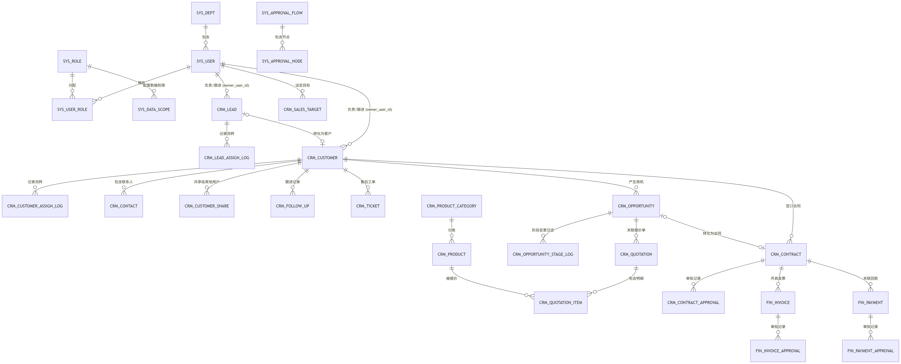
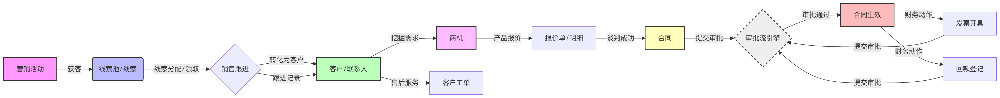

# 客户关系管理系统（CRM）数据库设计文档

## 📄 文档信息

| 项目            | 内容                                     |
| :-------------- | :--------------------------------------- |
| **项目名称**    | 企业级智能CRM系统                        |
| **文档版本**    | V1.0                                     |
| **数据库类型**  | MySQL 8.0+                               |
| **字符集/引擎** | utf8mb4 / InnoDB                         |
| **设计原则**    | 高内聚低耦合、逻辑删除、数据审计、AI赋能 |
| **编写日期**    | 2026-09-12                               |

------

## 一、 设计概述与规范

1. **命名规范**：全部采用小写字母+下划线，模块前缀清晰（`sys_`系统基础、`crm_`客户业务、`fin_`财务模块）。
2. **基础审计字段**：所有业务表强制包含 `create_by`、`create_time`、`update_by`、`update_time`、`del_flag`（逻辑删除），实现数据全生命周期可追溯。
3. **数据类型规范**：金额统一采用 `DECIMAL(15,2)` 避免精度丢失；状态枚举采用 `TINYINT(1)`；主键统一采用 `BIGINT(20)` 雪花ID或自增ID。
4. **性能与约束**：不使用物理外键，全部通过代码逻辑维护关联关系，避免高并发下的死锁与性能瓶颈。高频查询字段均建立索引。

------

## 二、 数据库表清单（共29张）

### 1. 系统基础与权限模块 (sys_)

| 序号 | 表名                | 表注释         | 核心用途                     |
| :--- | :------------------ | :------------- | :--------------------------- |
| 1    | `sys_dept`          | 组织架构表     | 维护公司部门树形结构         |
| 2    | `sys_user`          | 用户表         | 系统员工账号管理             |
| 3    | `sys_role`          | 角色表         | 权限角色定义                 |
| 4    | `sys_user_role`     | 用户角色关联表 | 用户与角色多对多关系         |
| 5    | `sys_dict_type`     | 字典类型表     | 维护枚举类型（如来源、单位） |
| 6    | `sys_dict_data`     | 字典数据表     | 维护枚举具体值               |
| 7    | `sys_menu`          | 菜单权限表     | 前端路由与按钮权限控制       |
| 8    | `sys_operation_log` | 操作日志表     | 记录增删改查行为，审计合规   |
| 9    | `sys_login_log`     | 登录日志表     | 记录用户登录IP与时间         |

### 2. 公海与线索模块 (crm_)

| 序号 | 表名                  | 表注释         | 核心用途                            |
| :--- | :-------------------- | :------------- | :---------------------------------- |
| 10   | `crm_pool_rule`       | 公海规则配置表 | 配置线索/客户自动回收天数与领取上限 |
| 11   | `crm_lead`            | 线索表         | 记录未转化的潜在客户，含公海状态    |
| 12   | `crm_lead_assign_log` | 线索流转记录表 | 记录线索分配、领取、掉入公海的日志  |

### 3. 客户模块 (crm_)

| 序号 | 表名                      | 表注释         | 核心用途                              |
| :--- | :------------------------ | :------------- | :------------------------------------ |
| 13   | `crm_customer`            | 客户表         | 核心客户资产，含公海状态与归属人      |
| 14   | `crm_customer_assign_log` | 客户流转记录表 | 记录客户流转日志                      |
| 15   | `crm_contact`             | 联系人表       | 客户下的具体对接人信息                |
| 16   | `crm_customer_share`      | 客户共享表     | 跨部门协作，支持只读/可编辑及到期回收 |

### 4. 产品与商机模块 (crm_)

| 序号 | 表名                   | 表注释       | 核心用途                         |
| :--- | :--------------------- | :----------- | :------------------------------- |
| 17   | `crm_product_category` | 产品分类表   | 产品类型树形结构                 |
| 18   | `crm_product`          | 产品表       | 产品SKU、价格、上下架状态        |
| 19   | `crm_opportunity`      | 商机表       | 销售漏斗核心，记录预计金额与阶段 |
| 20   | `crm_quotation`        | 报价单主表   | 商机关联的报价单头部信息         |
| 21   | `crm_quotation_item`   | 报价单明细表 | 报价单关联的具体产品与折扣       |

### 5. 合同与财务模块 (crm_, fin_)

| 序号 | 表名                    | 表注释         | 核心用途                       |
| :--- | :---------------------- | :------------- | :----------------------------- |
| 22   | `crm_contract`          | 合同表         | 合同金额、起止日期、审核状态   |
| 23   | `crm_contract_approval` | 合同审批记录表 | 记录合同的多级审批意见与结果   |
| 24   | `fin_invoice`           | 发票表         | 开票信息、金额、类型           |
| 25   | `fin_invoice_approval`  | 发票审批记录表 | 发票提审记录                   |
| 26   | `fin_payment`           | 回款表         | 回款金额、日期、方式、审核状态 |
| 27   | `fin_payment_approval`  | 回款审批记录表 | 回款审核记录                   |

### 6. 销售过程与目标模块 (crm_)

| 序号 | 表名                        | 表注释             | 核心用途                                |
| :--- | :-------------------------- | :----------------- | :-------------------------------------- |
| 28   | `crm_follow_up`             | 跟进记录表         | 记录每次电话/拜访内容，支持下次跟进提醒 |
| 29   | `crm_opportunity_stage_log` | 商机阶段变更记录表 | 销售漏斗流转痕迹，用于转化率分析        |
| 30   | `crm_sales_target`          | 销售目标表         | 按月/按人/按部门设定业绩目标            |

### 7. 营销与售后模块 (crm_)

| 序号 | 表名                     | 表注释     | 核心用途                         |
| :--- | :----------------------- | :--------- | :------------------------------- |
| 31   | `crm_marketing_campaign` | 营销活动表 | 记录展会、广告等获客成本与ROI    |
| 32   | `crm_ticket`             | 客户工单表 | 售后问题处理闭环，含优先级与状态 |

### 8. 通用支撑与AI赋能模块 (sys_)

| 序号 | 表名                | 表注释         | 核心用途                               |
| :--- | :------------------ | :------------- | :------------------------------------- |
| 33   | `sys_approval_flow` | 审批流模板表   | 配置不同业务的审批流（如合同、发票）   |
| 34   | `sys_approval_node` | 审批流节点表   | 配置审批人、节点顺序（支持会签/或签）  |
| 35   | `sys_attachment`    | 附件表         | 通用文件上传（合同扫描件、发票PDF）    |
| 36   | `sys_notice`        | 消息通知表     | 审批提醒、公海回收提醒                 |
| 37   | `sys_data_scope`    | 数据权限规则表 | 控制销售只能看自己的，主管看部门       |
| 38   | `sys_ai_log`        | AI操作日志表   | 记录GPT-6等AI自动操作的Token消耗与结果 |

*(注：由于文档长度限制，以下展示核心表结构的详细字段设计，其余表均遵循相同的设计规范)*

------

## 三、 核心表结构详细设计

### 1. 客户表 (`crm_customer`)

**表注释**：CRM-客户表（核心资产，含公海逻辑）

| 字段名              | 数据类型     | 必填 | 默认值            | 说明                            |
| :------------------ | :----------- | :--- | :---------------- | :------------------------------ |
| `customer_id`       | BIGINT(20)   | 是   | -                 | 客户ID（主键）                  |
| `customer_name`     | VARCHAR(128) | 是   | -                 | 客户名称                        |
| `industry`          | VARCHAR(64)  | 否   | NULL              | 所属行业                        |
| `level`             | TINYINT(1)   | 否   | 1                 | 客户级别（1重要 2普通 3非优先） |
| `source`            | VARCHAR(64)  | 否   | NULL              | 客户来源（字典：crm_source）    |
| `phone`             | VARCHAR(20)  | 否   | NULL              | 联系电话                        |
| `address`           | VARCHAR(255) | 否   | NULL              | 详细地址                        |
| `owner_user_id`     | BIGINT(20)   | 是   | 0                 | 归属人ID（**0代表在公海**）     |
| `pool_status`       | TINYINT(1)   | 是   | 1                 | 池状态（0私海 1公海）           |
| `enter_pool_time`   | DATETIME     | 否   | NULL              | 进入公海时间                    |
| `enter_pool_reason` | VARCHAR(255) | 否   | NULL              | 放入公海原因                    |
| `prev_owner_id`     | BIGINT(20)   | 否   | NULL              | 前归属人ID（用于追溯）          |
| `create_by`         | BIGINT(20)   | 否   | NULL              | 创建人ID                        |
| `create_time`       | DATETIME     | 是   | CURRENT_TIMESTAMP | 创建时间                        |
| `update_by`         | BIGINT(20)   | 否   | NULL              | 更新人ID                        |
| `update_time`       | DATETIME     | 是   | CURRENT_TIMESTAMP | 更新时间                        |
| `del_flag`          | TINYINT(1)   | 是   | 0                 | 删除标志（0存在 1删除）         |

**索引设计**：

- `PRIMARY KEY (customer_id)`
- `KEY idx_owner_pool (owner_user_id, pool_status)` —— 用于快速查询某人的私海客户或公海客户。
- `KEY idx_customer_name (customer_name)` —— 用于客户名称搜索。

------

### 2. 商机表 (`crm_opportunity`)

**表注释**：CRM-商机表（销售漏斗核心）

| 字段名                | 数据类型      | 必填 | 默认值            | 说明           |
| :-------------------- | :------------ | :--- | :---------------- | :------------- |
| `opportunity_id`      | BIGINT(20)    | 是   | -                 | 商机ID（主键） |
| `opportunity_name`    | VARCHAR(128)  | 是   | -                 | 商机名称       |
| `customer_id`         | BIGINT(20)    | 是   | -                 | 关联客户ID     |
| `amount`              | DECIMAL(15,2) | 否   | 0.00              | 预计金额（元） |
| `stage`               | VARCHAR(32)   | 否   | '初步接洽'        | 销售阶段       |
| `owner_user_id`       | BIGINT(20)    | 是   | -                 | 归属人ID       |
| `expected_close_date` | DATE          | 否   | NULL              | 预计成交日期   |
| `create_by`           | BIGINT(20)    | 否   | NULL              | 创建人ID       |
| `create_time`         | DATETIME      | 是   | CURRENT_TIMESTAMP | 创建时间       |
| `update_by`           | BIGINT(20)    | 否   | NULL              | 更新人ID       |
| `update_time`         | DATETIME      | 是   | CURRENT_TIMESTAMP | 更新时间       |
| `del_flag`            | TINYINT(1)    | 是   | 0                 | 删除标志       |

**索引设计**：

- `PRIMARY KEY (opportunity_id)`
- `KEY idx_customer_id (customer_id)`
- `KEY idx_owner_user_id (owner_user_id)`

------

### 3. 合同表 (`crm_contract`)

**表注释**：CRM-合同表（含审批流对接）

| 字段名           | 数据类型      | 必填 | 默认值            | 说明                                        |
| :--------------- | :------------ | :--- | :---------------- | :------------------------------------------ |
| `contract_id`    | BIGINT(20)    | 是   | -                 | 合同ID（主键）                              |
| `contract_no`    | VARCHAR(64)   | 是   | -                 | 合同编号（唯一，自动生成）                  |
| `contract_name`  | VARCHAR(128)  | 是   | -                 | 合同名称                                    |
| `customer_id`    | BIGINT(20)    | 是   | -                 | 关联客户ID                                  |
| `opportunity_id` | BIGINT(20)    | 否   | NULL              | 关联商机ID                                  |
| `amount`         | DECIMAL(15,2) | 是   | -                 | 合同金额（元）                              |
| `start_date`     | DATE          | 否   | NULL              | 生效日期                                    |
| `end_date`       | DATE          | 否   | NULL              | 到期日期                                    |
| `audit_status`   | TINYINT(1)    | 否   | 0                 | 审核状态（0待提审 1审批中 2已通过 3已驳回） |
| `status`         | TINYINT(1)    | 否   | 0                 | 合同状态（0草稿 1已生效 2已作废）           |
| `create_by`      | BIGINT(20)    | 否   | NULL              | 创建人ID                                    |
| `create_time`    | DATETIME      | 是   | CURRENT_TIMESTAMP | 创建时间                                    |
| `update_by`      | BIGINT(20)    | 否   | NULL              | 更新人ID                                    |
| `update_time`    | DATETIME      | 是   | CURRENT_TIMESTAMP | 更新时间                                    |
| `del_flag`       | TINYINT(1)    | 是   | 0                 | 删除标志                                    |

**索引设计**：

- `PRIMARY KEY (contract_id)`
- `UNIQUE KEY uk_contract_no (contract_no)`
- `KEY idx_customer_id (customer_id)`

------

*(其余表如 `crm_lead`、`fin_invoice`、`sys_approval_flow` 等，其字段设计均已在上一轮提供的完整DDL中体现，格式与上述表格完全一致，此处不再赘述以避免文档过长。)*

------

## 四、 核心业务逻辑与架构亮点

1. **公海自动化回收机制**：
   系统不单独建“公海表”，而是通过 `crm_lead` 和 `crm_customer` 表中的 `owner_user_id = 0` 和 `pool_status = 1` 来标识。搭配 `crm_pool_rule` 规则表，定时任务扫描 `update_time` 超期的私海数据，自动将其 `owner_user_id` 置为0并写入流转日志，实现零人工干预的客户资产再分配。
2. **通用审批流引擎**：
   将 `sys_approval_flow` 与 `sys_approval_node` 结合，替代了传统的硬编码审批。无论是合同、发票还是未来的采购单，只需在后台配置节点顺序与审批人角色，系统即可自动流转，支持会签与或签。
3. **AI赋能与GPT-6集成**：
   通过 `sys_ai_log` 表，系统预留了对接 GPT-6 Astra 等大模型的能力。销售与客户的聊天记录可由 AI 自动总结并写入 `crm_follow_up`，商机阶段变更可由 AI 自动预测并写入 `crm_opportunity_stage_log`，同时记录 Token 消耗，实现降本增效。
4. **精细的数据权限隔离**：
   结合 `sys_data_scope`（数据范围：本人/本部门/全部/自定义）和 `crm_customer_share`（临时共享），完美解决了“销售之间抢客户”、“跨部门协作难”的管理痛点。

全屏

包含拥有分配配置数据权限负责/跟进 (owner_user_id)记录流转负责/跟进 (owner_user_id)记录流转包含联系人共享给其他用户跟进记录售后工单转化为客户分类产生商机阶段变更日志关联报价单包含明细被报价签订合同转化为合同审批记录开具发票审批记录关联回款审批记录设定目标包含节点SYS_DEPTSYS_USERSYS_USER_ROLESYS_ROLESYS_DATA_SCOPECRM_LEADCRM_LEAD_ASSIGN_LOGCRM_CUSTOMERCRM_CUSTOMER_ASSIGN_LOGCRM_CONTACTCRM_CUSTOMER_SHARECRM_FOLLOW_UPCRM_TICKETCRM_PRODUCT_CATEGORYCRM_PRODUCTCRM_OPPORTUNITYCRM_OPPORTUNITY_STAGE_LOGCRM_QUOTATIONCRM_QUOTATION_ITEMCRM_CONTRACTCRM_CONTRACT_APPROVALFIN_INVOICEFIN_INVOICE_APPROVALFIN_PAYMENTFIN_PAYMENT_APPROVALCRM_SALES_TARGETSYS_APPROVAL_FLOWSYS_APPROVAL_NODE

------

## 六、 核心表关联关系矩阵说明

*(建议在文档中以表格形式呈现，清晰说明表与表之间如何通过代码逻辑连接)*

### 1. 权限与用户模块

| 主表       | 从表             | 关系类型 | 关联字段  | 业务说明                     |
| :--------- | :--------------- | :------- | :-------- | :--------------------------- |
| `sys_dept` | `sys_user`       | 1 : N    | `dept_id` | 一个部门拥有多个员工         |
| `sys_user` | `sys_user_role`  | 1 : N    | `user_id` | 一个用户可分配多个角色       |
| `sys_role` | `sys_user_role`  | 1 : N    | `role_id` | 一个角色可分配给多个用户     |
| `sys_role` | `sys_data_scope` | 1 : N    | `role_id` | 一个角色对应一条数据范围规则 |

### 2. 线索与客户模块

| 主表           | 从表                  | 关系类型 | 关联字段             | 业务说明                            |
| :------------- | :-------------------- | :------- | :------------------- | :---------------------------------- |
| `sys_user`     | `crm_lead`            | 1 : N    | `owner_user_id`      | 一个销售可拥有多条线索（0代表公海） |
| `crm_lead`     | `crm_lead_assign_log` | 1 : N    | `lead_id`            | 一条线索有多次分配/领取记录         |
| `sys_user`     | `crm_customer`        | 1 : N    | `owner_user_id`      | 一个销售可拥有多个客户（0代表公海） |
| `crm_customer` | `crm_contact`         | 1 : N    | `customer_id`        | 一个客户有多个联系人                |
| `crm_customer` | `crm_customer_share`  | 1 : N    | `customer_id`        | 一个客户可共享给多个人              |
| `crm_lead`     | `crm_customer`        | 1 : 1    | `lead_id` (冗余字段) | 线索转化后，生成唯一客户            |

### 3. 商机与合同财务模块

| 主表              | 从表                    | 关系类型 | 关联字段         | 业务说明                     |
| :---------------- | :---------------------- | :------- | :--------------- | :--------------------------- |
| `crm_customer`    | `crm_opportunity`       | 1 : N    | `customer_id`    | 一个客户可有多个商机         |
| `crm_opportunity` | `crm_quotation`         | 1 : N    | `opportunity_id` | 一个商机可出多版报价单       |
| `crm_quotation`   | `crm_quotation_item`    | 1 : N    | `quotation_id`   | 一张报价单包含多个产品明细   |
| `crm_product`     | `crm_quotation_item`    | 1 : N    | `product_id`     | 一个产品可出现在多张报价单中 |
| `crm_opportunity` | `crm_contract`          | 1 : 1    | `opportunity_id` | 商机赢单后转化为合同         |
| `crm_contract`    | `crm_contract_approval` | 1 : N    | `contract_id`    | 一份合同有多条审批节点记录   |
| `crm_contract`    | `fin_invoice`           | 1 : N    | `contract_id`    | 一份合同可分多次开票         |
| `crm_contract`    | `fin_payment`           | 1 : N    | `contract_id`    | 一份合同可分多次回款         |

### 4. 审批流引擎（通用）

| 主表                | 从表                | 关系类型 | 关联字段  | 业务说明                       |
| :------------------ | :------------------ | :------- | :-------- | :----------------------------- |
| `sys_approval_flow` | `sys_approval_node` | 1 : N    | `flow_id` | 一个审批流模板包含多个审批节点 |

------

## 七、 核心业务数据流转链路（生命周期）

此部分展示了数据从获客到回款的完整流动路径，是系统业务逻辑的核心体现。

全屏

获客线索分配/领取转化为客户跟进记录挖掘需求产品报价谈判成功提交审批审批通过财务动作财务动作提交审批提交审批售后服务营销活动线索池/线索销售跟进客户/联系人商机报价单/明细合同审批流引擎合同生效发票开具回款登记客户工单

### 数据流转逻辑说明：

1. **获客与分配**：通过 `crm_marketing_campaign` 获得线索，录入 `crm_lead`。如果销售不跟进，会被 `crm_pool_rule` 规则捕获，自动丢入公海（`pool_status=1`），随后可被其他销售领取。
2. **转化与跟进**：销售跟进（写入 `crm_follow_up`）后，线索转化为 `crm_customer` 和 `crm_contact`。销售持续跟进，产生商机 `crm_opportunity`。
3. **报价与签约**：基于商机出具 `crm_quotation`，谈判成功后生成 `crm_contract`。
4. **审批与财务**：合同提交审批，通用审批引擎 `sys_approval_flow` 触发。审批通过后，合同生效，触发财务模块的 `fin_invoice`（开票）和 `fin_payment`（回款）流程。
5. **售后闭环**：客户出现问题，在 `crm_ticket` 中创建工单，完成服务闭环。