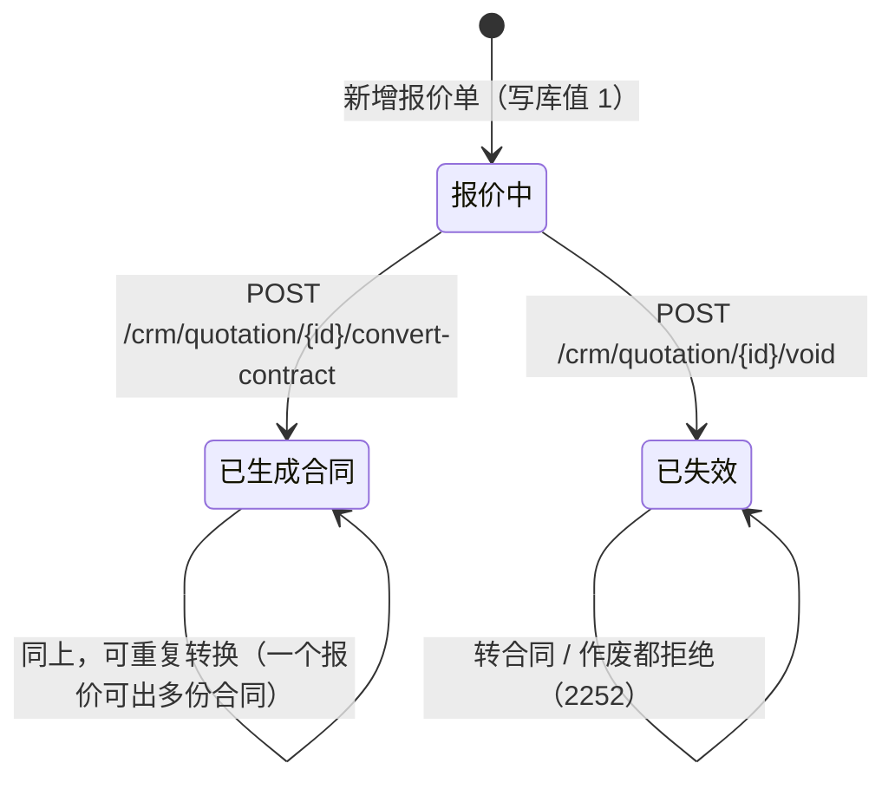
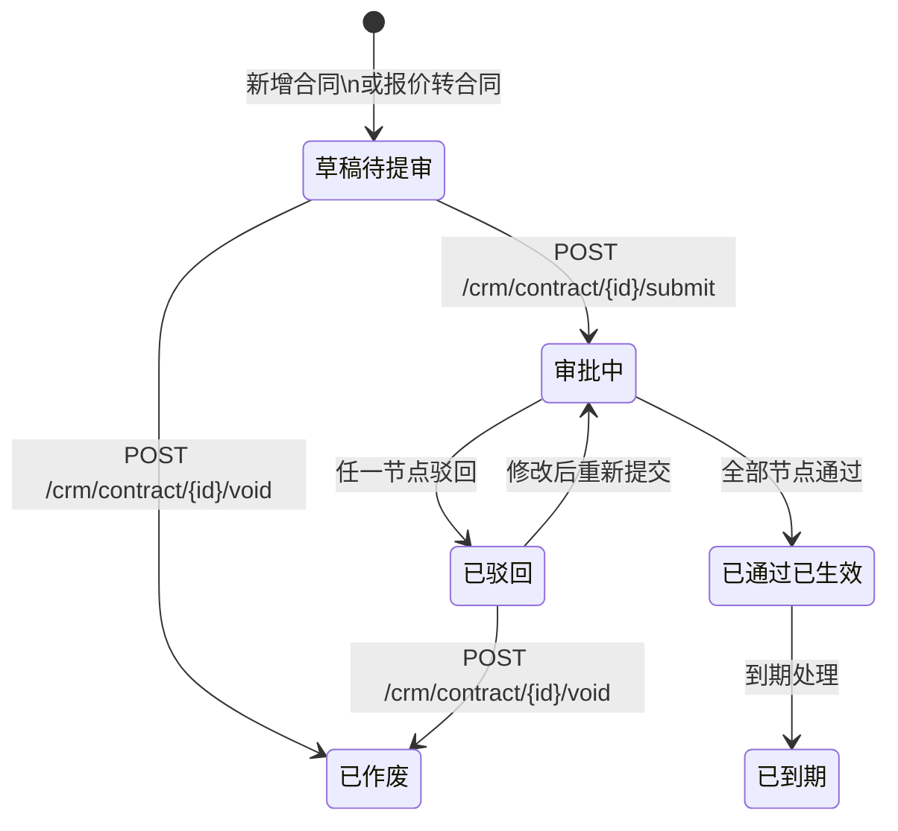
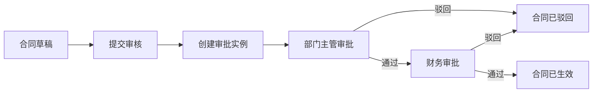
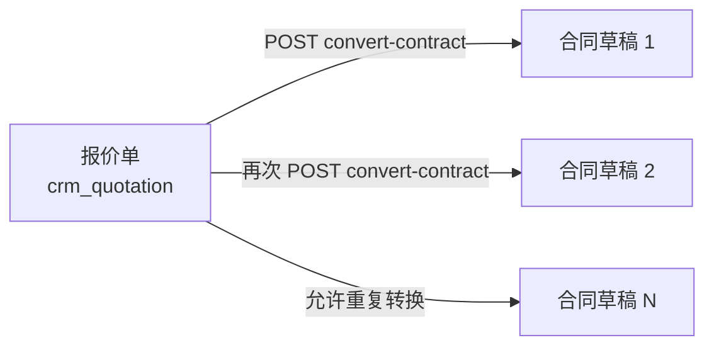

# 报价合同组状态流转图

> ## ⚠️ 先确认哪些流转有接口
>
> 本文档描述的是**状态机设计**，其中只有一部分流转已经落到接口上。
> 读之前先看这张表，别照着图去找不存在的接口：
>
> | 流转 | 接口 | 状态 |
> | :--- | :--- | :--- |
> | 合同 提交审核 | `POST /crm/contract/{id}/submit` | ✅ 已实现 |
> | 合同 审核（通过/驳回） | `POST /crm/contract/{id}/audit`、`POST /crm/contract/batch-audit` | ✅ 已实现 |
> | 合同 作废 | `POST /crm/contract/{id}/void` | ✅ 已实现 |
> | **报价 转合同** | `POST /crm/quotation/{id}/convert-contract` | ✅ 已实现（转出合同草稿，报价单转「已生成合同」） |
> | **报价 作废** | `POST /crm/quotation/{id}/void` | ✅ 已实现（仅「报价中」，转「已失效」） |
> | 报价 发送 / 接受 / 拒绝 | — | ❌ 未实现，无端点（库值 `0 草稿` / `3 已拒绝` 只读保留） |
> | 合同 到期处理 | — | ❌ 未实现（需定时任务） |
>
> 合同的审批状态机**没有独立模块**：它写死在 `ContractServiceImpl` 里，
> 直接用 `sys_approval_flow/node/instance/task` 四张表（`crm-module-bpm` 目前是空模块）。

## 1. 报价单状态

### 1.1 库里的 5 个码值 ↔ 前端的 3 个标签

`crm_quotation.status` 是 `TINYINT`，有 5 个码值；而列表的筛选胶囊与状态标签只有 3 个中文口径。
映射是**多对一归并（读）+ 单对一代表示（写）**，唯一实现在 `QuotationStatus`：

| 库值 | DDL 注释 | 对外标签 | 谁写它 |
| :--- | :--- | :--- | :--- |
| 0 | 草稿 | 报价中 | —（无生产者，历史数据仍可读） |
| 1 | 已发出 | 报价中 | 新增报价单 |
| 2 | 已接受 | **已生成合同** | `POST /crm/quotation/{id}/convert-contract` |
| 3 | 已拒绝 | 已失效 | —（无生产者，历史数据仍可读） |
| 4 | 已作废 | 已失效 | `POST /crm/quotation/{id}/void` |

> **为什么 2 的标签叫「已生成合同」而不是「已接受」**：库里这一列的注释是历史命名，
> 而业务上走到 2 的唯一路径就是「按这份报价生成了合同」（种子数据里 `status = 2` 的报价单，
> 备注写的正是「客户已接受」，且都有一条 `crm_contract.quotation_id` 指回来）。
> 对外只暴露 3 个标签，口径见 `QuotationStatus` 的类注释。

### 1.2 流转



### 1.3 操作限制矩阵

| 状态 | 库值 | 编辑 | 删除 | 转合同 | 作废 |
| :--- | :--- | :---: | :---: | :---: | :---: |
| 报价中 | 0 / 1 | 允许 | 允许 | **允许** | **允许** |
| 已生成合同 | 2 | 允许 | 允许 | **允许**（重复生成） | 不允许 → `2252` |
| 已失效 | 3 / 4 | 允许 | 允许 | 不允许 → `2252` | 不允许 → `2252` |

- **转合同的额外前置**：报价单必须至少有 1 行明细（合同明细不允许为空），否则 `2252`。
- **编辑不会带走状态**：`PUT /crm/quotation/{id}` 里的 `status` 只做「标签是否变化」的比对，
  与当前库值的归并标签相同就不写该列 —— 否则一张 `0 草稿` 的单子被编辑一次就会静默升级成 `1 已发出`。
  前端表单里状态是**只读展示**，改状态只能走上面那两个动作。
- **报价单没有公海**：`owner_user_id` 是 `NOT NULL`，数据权限只有 `data_scope`（见《04-权限设计文档》3.4）。

## 2. 合同状态

合同使用两个字段表达状态：

- `audit_status`：`0待提审`、`1审批中`、`2已通过`、`3已驳回`
- `status`：`0草稿`、`1已生效`、`2已作废`、`3已到期`



其中“草稿待提审”表示 `audit_status=0,status=0`，“已驳回”表示
`audit_status=3,status=0`，“审批中”表示 `audit_status=1,status=0`，
“已通过已生效”表示 `audit_status=2,status=1`。

## 3. 合同多级审批推进



审批模板使用 `CONTRACT_AUDIT`。当前 SQL 默认配置为：

1. 节点 1：部门主管审批，发起人直属上级；
2. 节点 2：财务审批，角色 ID `4`；
3. 节点顺序由 `sys_approval_node.node_order` 决定，后续可通过配置增加节点。

审批方式实现：

- 或签：任一审批人通过后，同节点其他待办标记为跳过；
- 会签：同节点全部审批人通过后才进入下一节点，任一驳回结束流程；
- 依次：按解析出的审批人顺序逐个创建任务。

驳回后重新提交会创建新的审批实例，历史实例保留。

### 3.1 怎么看进度：现在该谁审 ⭐

**合同那一列在整个流程里都是「审核中」** —— `audit_status` 只在**最后一个节点通过**时才变成
`2 已通过`（代码在 `ContractServiceImpl#audit` 的「没有下一节点」分支）。所以「主管已审完」
之后合同依旧显示「审核中」，看列表是**看不出球在谁手上**的。要看进度有两个入口：

| 入口 | 能回答什么 |
| :--- | :--- |
| `GET /crm/contract/{id}/approval` | 完整链路：每个节点是**谁**审的、什么时候、什么意见；哪些人被跳过；**当前节点 + 当前待办人**；**下一步节点 + 预计审批人**；数据异常提示。见《05-接口文档》合同模块 |
| `GET /crm/contract/audit-list`（每行） | `currentNodeName` / `pendingApproverNames`（现在该谁审）、`nextNodeName` / `nextApproverNames`（下一步到谁）、`applyUserName` / `applyTime`（提交人 / 提交时间） |

**前端在哪看**：合同审核页的「当前环节」「下一步」两列（点一下打开**审批进度弹窗**）、
合同详情页的「**审批进度**」Tab —— 两处共用 `views/crm/contract/ApprovalProgress.vue`
（时间轴：每步谁审的 + 意见 + 时间，未到达的节点标「预计审批人」）。

> 「预计审批人」由后端按节点配置**预解析**（规则与真实解析 `resolveApprovers` 同源）：
> 指定用户 / 角色成员 / 发起人直属上级 / 发起人本人。它是**预计** ——
> 组织架构、角色成员、流程配置变了就不同；为空表示**配置有问题**（走到那一步会失败）。

> ⚠️ 演示数据里 `HT20260003`（合同 id=3）是「审核中」但**没有审批实例**（种子数据漏建了
> `sys_approval_instance` / `sys_approval_task`），任何审批动作都返回 `4003 审批实例不存在`。
> 这种坏数据会被上面那个接口的 `abnormalHint` 明确指出。

## 4. 报价转合同关系 ✅ 已实现

`POST /crm/quotation/{id}/convert-contract` → 返回**新合同 ID**（代码在
`QuotationServiceImpl#convertToContract`）。



实现要点：

1. **合同那一侧复用已交付的合同创建接口**（`ContractService#create`）：编号走 `CONTRACT`
   编号规则、明细行金额按 3.6 重算、`amount = Σ 明细`，落到 `auditStatus = 0 待提审` /
   `status = 0 草稿`。报价单侧只负责「凑请求体」与「推进自己的状态」，**合同模块一行都不用改**，
   也就不存在两套金额口径。
2. **合同明细来自报价明细**：`ContractItemReqVO` 里没有 `amount` 字段，搬过去的是「金额的输入」
   （数量 / 含税单价 / 折扣率 / 税率），由合同侧按 3.6 重算。报价单的行金额本来就出自同一公式、
   同一次最终四舍五入，正常数据下两边逐行相等；合同的 `amount = Σ 明细` 因此恒成立。
3. **归属人取报价单的负责人，不取登录人**：主管替下属转合同时，合同应当还是下属的。
4. **合同通过 `quotation_id` 指回报价单**（1:N）：列表的「关联合同」列按它反查，只显示最新一份。
5. **转换成功后报价单状态转为「已生成合同」**（库值 2），用条件更新
   （`WHERE status IN (0,1,2)`）推进 —— 期间若被并发作废则影响 0 行，整笔回滚，
   不会留下「报价单已失效、合同却建好了」的孤儿数据。

> 转换出来的是**草稿待提审**合同，之后走 §2 的 `submit → audit` 流程，
> 与在合同页自己新增的合同没有区别。

> ⚠️ **已知偏差（属合同侧，未改）**：`ContractServiceImpl#create` 把 `dept_id` 写成**登录人**的部门，
> 而 `owner_user_id` 我们传的是报价单负责人。主管跨部门代下级转合同时两者可能不一致，
> 会让该下级所在部门的主管用「本部门」范围看不到这份合同。本人仍能看到（按 owner 过滤）。
> 要不要对齐由合同模块的负责人决定。

## 5. 金额计算口径

明细中 `unitPrice` 为含税单价，金额由后端计算：

```text
折后单价 = unitPrice × (1 - discountRate / 100)
含税行金额 = ROUND(quantity × 折后单价, 2)
行不含税金额 = ROUND(含税行金额 / (1 + taxRate / 100), 2)
行税额 = 含税行金额 - 行不含税金额

报价 total_with_tax = Σ 含税行金额
报价 total_amount = Σ 行不含税金额
报价 tax_amount = total_with_tax - total_amount
合同 amount = Σ 合同明细含税行金额
```

## 6. 合同操作限制矩阵

> 报价单的矩阵在 §1.3（本节只讲合同）。

| 状态 | 编辑 | 删除 | 作废 | 提交审核 | 审核 |
|---|---:|---:|---:|---:|---:|
| 合同草稿/待提审 | 允许 | 允许 | 允许 | 允许 | 不允许 |
| 合同审批中 | 不允许 | 不允许 | 不允许 | 不允许 | 按当前任务 |
| 合同已驳回 | 允许 | 允许 | 允许 | 允许 | 不允许 |
| 合同已通过/已生效 | 不允许 | 不允许 | 不允许 | 不允许 | 不允许 |
| 合同已作废 | 不允许 | 不允许 | 不允许 | 不允许 | 不允许 |

